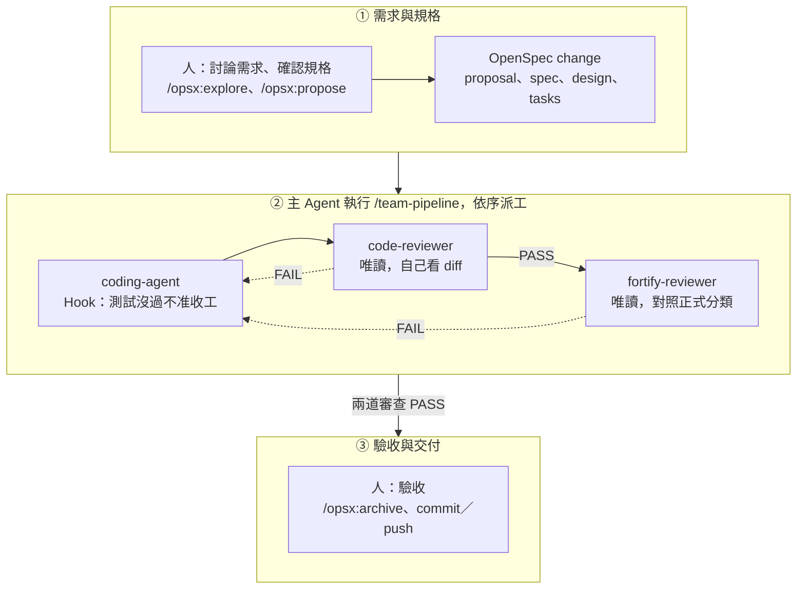

# AI Coding Agent Team Workshop：從 Spec 到交付（Claude Code CLI 版）

本 Workshop 使用 **Claude Code CLI**。先把一套寫好的 Agent Team 配置到起始專案，再用一個新需求，從 OpenSpec 討論需求開始，一路走到程式碼交付。

**閱讀方式**：每個 STEP 只要看「本步目標、操作、如何確認成功」三段就能往下做。每步最後的「原理解說」預設收合，等待 Agent 回應或課後再展開。

**兩個終端機**：整個 Workshop 開兩個終端機視窗，都位於 TicketWorkshop 根目錄。

- **終端機 A**：執行 `claude`，跟 Claude Code 對話。
- **終端機 B**：PowerShell 7，人自己執行的命令（驗證、啟動網站、git commit）。

## 步驟總覽

| STEP | 做什麼                 | 完成時看到的結果                                     |
| ---- | ---------------------- | ---------------------------------------------------- |
| 0    | 課前準備               | 五個版本命令都有輸出，Claude Code 已登入             |
| 1    | 取得專案並確認可以建置 | `VERIFY PASSED`，網站可以開啟                        |
| 2    | 安裝並初始化 OpenSpec  | OpenSpec 1.14.1，`/opsx:*` 指令已產生                |
| 3    | 設定團隊規範           | `CLAUDE.md`、`AGENTS.md` 與六份規範                  |
| 4    | 設定 Skills            | 四個團隊 Skill                                       |
| 5    | 設定子 Agent 與 Hooks  | 三個子 Agent、兩支 hook 腳本、權限設定，已信任專案   |
| 6    | 確認配置並提交         | Claude Code 讀到團隊配置，配置已提交                 |
| 7    | 討論需求               | 七項行為有共識                                       |
| 8    | 產生 OpenSpec 規格     | proposal、spec、design、tasks                        |
| 9    | 啟動 team-pipeline     | Coding 子 Agent 實作，build/test 通過                |
| 10   | 觀察兩道審查           | Code Review、Fortify 預檢 PASS                       |
| 11   | 關卡演練               | Code Review 擋下被弱化的測試                         |
| 12   | 執行網站與交付         | 網站可操作，change 已封存，成果已提交                |

## 流程總覽



人負責兩端：前面用 OpenSpec 討論需求、確認規格，最後驗收、封存規格並自己 commit 與 push。中間由主 Agent 執行 team-pipeline 依序派工：Coding 寫完由 Hook 驗證，主 Agent 再驗一次後交給 Code Review，PASS 才交給 Fortify 預檢。任一道審查 FAIL 都退回 Coding，修正後 build、test 與兩道審查全部重跑。

<details>
<summary>專案結構</summary>

```text
TicketWorkshop/
├─ Workshop.slnx                方案
├─ src/                         Domain、Application、Infrastructure、Web 四層（目前只有 MVC 範本）
├─ tests/                       Domain、Web 測試專案，以及架構相依測試
├─ eng/verify.ps1               團隊唯一的驗證入口：restore、build、test
├─ Directory.Build.props        警告視為錯誤、分析器等級
├─ .editorconfig                命名規則，建置時檢查
├─ nuget.config                 套件快取放在專案內的 .nuget/
├─ docs/project-context.md      本專案的層級對照與執行方式
└─ team-kit/                    要配置進專案的 Agent Team 檔案
   ├─ CLAUDE.md                 Claude Code 入口，匯入 AGENTS.md
   ├─ AGENTS.md                 團隊入口
   ├─ docs/team-rules/          共通行為準則與五份技術規範
   ├─ claude/skills/            四個 Skill（STEP 4 複製到 .claude/skills/）
   ├─ claude/agents/            三個子 Agent（STEP 5 複製到 .claude/agents/）
   ├─ claude/settings.json      權限設定（STEP 5 複製到 .claude/）
   ├─ eng/                      兩支 hook 腳本
   └─ openspec/config.yaml      OpenSpec 指引
```

建置規則與架構測試屬於專案本身，已經放在根目錄。team-kit 是 AI 協作的配置，STEP 2 到 5 逐一放進專案。team-kit 裡的 Claude Code 設定放在沒有點的 `claude/`，複製進專案時才放到 `.claude/`：Claude Code 會探索子目錄裡的 `.claude/skills/`，如果 team-kit 裡也有 `.claude/`，就可能讀到重複的 Skill。

</details>

---

## STEP 0｜課前準備

**本步目標**

裝好工具，登入 Claude Code，確認命令列都能執行。

**操作**

1. 安裝 [.NET 10 SDK](https://dotnet.microsoft.com/download/dotnet/10.0)、[Node.js](https://nodejs.org/en/download) 20.19 以上、[Git for Windows](https://git-scm.com/downloads)、[PowerShell 7](https://learn.microsoft.com/powershell/scripting/install/installing-powershell-on-windows)。Windows 可用 `winget install --id Microsoft.PowerShell --source winget` 安裝 PowerShell 7。
2. 安裝 Claude Code CLI，在 PowerShell 執行：

```powershell
irm https://claude.ai/install.ps1 | iex
```

3. 開新的 PowerShell 7 視窗，執行：

```powershell
dotnet --list-sdks
node --version
git --version
pwsh --version
claude --version
```

4. 執行 `claude`，依畫面完成登入後輸入 `/exit` 離開。

**如何確認成功**

- [ ] `dotnet --list-sdks` 列出 10.x
- [ ] `node --version` 為 v20.19 以上
- [ ] `git --version` 有版本輸出，`pwsh --version` 為 7.x
- [ ] `claude --version` 有版本輸出，且已完成登入

<details>
<summary>原理解說：為什麼要 Git for Windows 與 PowerShell 7</summary>

- **Git for Windows 提供 Git Bash。** Claude Code 在 Windows 上用 Git Bash 執行 Bash 工具。本 Workshop 的子 Agent 都透過 Bash 工具執行命令（Coding 跑驗證、Reviewer 跑唯讀 git），Reviewer 的命令限制也是掛在 Bash 工具上。沒有 Git Bash 時，Claude Code 會改用 PowerShell 工具，子 Agent 的工具設定就對不上。
- **驗證與 hook 腳本用 PowerShell 7。** Windows 內建的 powershell.exe 是 5.1；`eng/` 下的腳本都以 `pwsh` 執行，從 Git Bash 呼叫也一樣。

</details>

---

## STEP 1｜取得專案並確認可以建置

**本步目標**

取得起始專案，確認它能建置、測試與執行。

**操作**

在終端機 B 執行：

```powershell
git clone <講師提供的 repository 網址> TicketWorkshop
cd TicketWorkshop
pwsh -NoProfile -File eng/verify.ps1
dotnet run --project src/Workshop.Web
```

網站啟動後瀏覽 `http://localhost:5107`，看到首頁後按 Ctrl+C 停止。之後兩個終端機都在 TicketWorkshop 根目錄操作。

**如何確認成功**

- [ ] verify 依序跑完 restore、build、三個測試專案，最後輸出 `VERIFY PASSED`
- [ ] 架構測試 4 個全部通過；Domain、Web 測試專案目前沒有測試
- [ ] 專案內出現 `.nuget/packages`（第一次 restore 需要網路）
- [ ] 瀏覽器看到 MVC 首頁

<details>
<summary>原理解說：verify.ps1 為什麼是專案本身的關卡</summary>

- **LLM 驗證不可靠。** 依賴 prompt 要求驗證專案的 restore、build 與測試結果，無法保證每次 LLM 都會正確執行，因此需要一個可靠的工具來統一判定。
- **唯一的驗證入口。** `eng/verify.ps1` 依序執行 restore、build、三個測試專案，任何一步失敗就 exit 1。開發者、Coding 子 Agent、Coding 結束時的 hook、主 Agent 都呼叫這一支。命令只維護一份，大家對「通過」的判定才一致。
- **驗證和 hook 分成兩支。** `verify.ps1` 只負責驗證，不知道是誰呼叫它。STEP 5 的 `verify-on-stop.ps1` 才是 hook：呼叫 verify、決定擋下或放行、計次、寫紀錄。
- **腳本每次執行時自動先刪 `TestResults/`。** 避免模型讀到舊的 TRX，當成這次的測試證據。
- **能交給工具判定的，就交給工具。** `Directory.Build.props` 把警告視為錯誤、開啟 `latest-recommended` 分析器與 `EnforceCodeStyleInBuild`；`.editorconfig` 的命名規則（IDE1006）在 build 時檢查；架構測試用 NetArchTest 檢查層級相依。這些由編譯器和測試判定，每次結果相同，模型也繞不過。Code Review 留給工具判斷不了的部分，例如責任是否放對層、測試是否真的驗證 Spec。
- **專案特有的事實集中在 `docs/project-context.md`。** 層級對照、驗證命令、既有狀態都寫在這裡。規範與 Skill 只寫可以跨專案重用的內容，換專案時只換這一份。

</details>

---

## STEP 2｜安裝並初始化 OpenSpec

**本步目標**

安裝指定版本的 OpenSpec，為 Claude Code 產生 OpenSpec 指令，並換上團隊的 OpenSpec 指引。

**操作**

在終端機 B 執行：

```powershell
npm install -g @fission-ai/openspec@1.14.1
openspec --version
openspec init --tools claude --no-animation
Copy-Item team-kit/openspec/config.yaml openspec/config.yaml -Force
```

**如何確認成功**

- [ ] `openspec --version` 顯示 1.14.1
- [ ] `.claude/commands/opsx/` 下有 explore、propose、apply、archive 等指令檔
- [ ] `.claude/skills/` 下有 `openspec-` 開頭的 Skills
- [ ] `openspec/config.yaml` 的 `operations` 段落有 `apply` 與 `archive` 的 guidance

<details>
<summary>原理解說：為什麼要改寫 apply 與 archive 的指引</summary>

`operations.apply.guidance` 要求不要在目前的上下文實作，改請使用者輸入 `/team-pipeline` 啟動團隊流程；`operations.archive.guidance` 要求使用者驗收後才封存。

- **apply 會繞過流程。** OpenSpec 的 apply 指引會讓目前這個 Agent 照 tasks 直接寫到底，Code Review 與安全預檢都被跳過。guidance 是給模型的指引，模型仍可能忽略，所以 AGENTS.md 與 team-pipeline Skill 也寫了同樣的規則，多處一致。
- **規格要累積成系統現況。** 每個 change 只記 ADDED、MODIFIED、REMOVED 的差異。驗收後由人執行 archive，把差異併入 `openspec/specs/`，下一個需求才有 baseline 可以比對。主 Agent 不自行 archive。
- **`context` 只寫團隊共通背景。** 業務需求屬於每一次 change；寫進 config 會變成每個 change 都套用的固定條件。
- **全域安裝並指定版本。** OpenSpec 產生的指令檔直接呼叫 `openspec` 命令，執行檔必須在 PATH 裡，所以採用官方的全域安裝方式。安裝時指定 `@1.14.1`，讓每位學員看到的指令與行為一致。
- **Claude Code 的指令名稱。** `--tools claude` 產生的指令放在 `.claude/commands/opsx/`，在 Claude Code 裡輸入 `/opsx:explore`、`/opsx:propose`、`/opsx:archive`。

</details>

---

## STEP 3｜設定團隊規範

**本步目標**

放入 Claude Code 入口 `CLAUDE.md`、團隊入口 `AGENTS.md` 與六份團隊規範。

**操作**

在終端機 B 執行：

```powershell
Copy-Item team-kit/CLAUDE.md, team-kit/AGENTS.md .
Copy-Item team-kit/docs/team-rules docs -Recurse
```

開啟 `CLAUDE.md`、`AGENTS.md` 與 `docs/team-rules/`，瀏覽內容與規則編號即可。

**如何確認成功**

- [ ] 根目錄有 `CLAUDE.md` 與 `AGENTS.md`，`CLAUDE.md` 第一行是 `@AGENTS.md`
- [ ] `docs/team-rules/` 有六份規範：core-principles、architecture、naming、code-quality、testing、security
- [ ] 每條規則都有編號，例如 ARCH-05、TEST-07
- [ ] `AGENTS.md` 有「小修改出口」段落

<details>
<summary>原理解說：入口、規範分工，以及小修改出口</summary>

| 檔案            | 規範內容                                                                 | 規則編號    | 由工具檢查的部分                                                          |
| --------------- | ------------------------------------------------------------------------ | ----------- | ------------------------------------------------------------------------- |
| architecture.md | 分層責任與相依方向、資料存取放在哪一層、交易與並行一致性                 | ARCH-01～09 | 層級相依由架構測試檢查（ARCH-01、02、03、05、06）                         |
| naming.md       | 型別、成員、介面、非同步方法的命名；領域用語與 Spec 一致                 | NAME-01～05 | NAME-01、02 由 `.editorconfig` 在 build 時檢查                            |
| code-quality.md | 變更範圍、非同步、錯誤處理、nullable、執行緒安全、日誌、編譯警告         | CODE-01～08 | CODE-07 由警告視為錯誤在 build 時擋下                                     |
| testing.md      | 接受情境要有對應測試、各層的測試責任、回歸測試、不得弱化測試             | TEST-01～07 | 測試是否通過由 `eng/verify.ps1` 判定；是否驗證到 Spec 由 Code Review 判定 |
| security.md     | 機密、輸入驗證與輸出編碼、CSRF、Cookie、日誌、錯誤訊息、正規表示式逾時等 | SEC-01～13  | 無；由 Fortify 預檢依這份檢查，並對照正式 Fortify 分類                    |

`core-principles.md` 是四條共通行為準則（先想清楚再寫、簡單優先、精準修改、以可驗證的目標推進），所有角色都適用。

- **CLAUDE.md 匯入 AGENTS.md。** 專案裡同時有 CLAUDE.md 與 AGENTS.md 時，Claude Code 只自動載入 CLAUDE.md。所以 CLAUDE.md 第一行用 `@AGENTS.md` 匯入團隊入口，下面只寫 Claude Code 專屬的補充。團隊規則只維護 AGENTS.md 一份，換工具時不用重寫。
- **AGENTS.md 只當入口。** 它列出規範位置、工作流程與元件入口，不重複規範內容。
- **每條規則有編號與強度。** Reviewer 的 finding 引用編號，Coding 修正時知道依據；必要規則違反是阻擋問題，建議只提醒。沒有編號，finding 容易變成「不符合 DDD」這種無法執行的意見。
- **明文禁止改規則來過關。** AGENTS.md 寫明，未經授權不得修改規範、Skill、Agent、`eng/` 腳本、hook、建置設定或架構測試來消除失敗；TEST-07 禁止刪除、跳過或弱化測試。
- **commit 與 push 由人執行。** 這條寫在 AGENTS.md，STEP 5 的 `.claude/settings.json` 也直接禁止 Claude 執行 `git commit` 與 `git push`。
- **小修改有明確出口，由人宣告。** 改一行文案、調一個設定值，不必走完整的 SDD 流程。你明確說「小修改，不走 team-pipeline」，主 Agent 就直接修改，不建立 OpenSpec change、不委派子 Agent，但改完仍要執行 `eng/verify.ps1` 並回報結果。主 Agent 不能自己判定「這算小修改」：交給模型判斷，等於讓它可以把任何需求說成小修改來跳過審查。
- **規範、Skill、Spec 分開放。** 規範是「做到什麼程度」，Skill 是「怎麼做」，Spec 是「這次做什麼」。換專案時換規範，換需求時換 Spec，Skill 不用動。
- **`.editorconfig` 怎麼變成關卡。** 只有 `.editorconfig` 時，命名違規只會在編輯器顯示提示，build 照樣成功；`Directory.Build.props` 再加上 `EnforceCodeStyleInBuild` 與 `TreatWarningsAsErrors`，命名違規就會讓 build 失敗。

</details>

---

## STEP 4｜設定 Skills

**本步目標**

放入主 Agent 用的流程 Skill，以及三個子 Agent 用的工作者 Skill。

**操作**

在終端機 B 執行：

```powershell
Copy-Item team-kit/claude/skills/* .claude/skills -Recurse
```

開啟 `.claude/skills/team-pipeline/SKILL.md` 與 `.claude/skills/code-review/SKILL.md`，看 frontmatter。

**如何確認成功**

- [ ] `.claude/skills/` 下有 team-pipeline、mvc-coding、code-review、fortify-preverify 四個資料夾，各有 SKILL.md（另有 STEP 2 產生的 `openspec-` 開頭 Skills）
- [ ] 四個 SKILL.md 都設了 `disable-model-invocation: true`
- [ ] mvc-coding、code-review、fortify-preverify 另外設了 `user-invocable: false`

<details>
<summary>原理解說：Skill 的分工與自動觸發設定</summary>

| Skill             | 內容                             | 使用者               | 啟動方式                               |
| ----------------- | -------------------------------- | -------------------- | -------------------------------------- |
| team-pipeline     | 流程：派工、判讀回報、決定下一步 | 主 Agent             | 使用者輸入 `/team-pipeline`            |
| mvc-coding        | 實作方法                         | coding-agent         | 子 Agent 依 Agent 檔的路徑讀取         |
| code-review       | 工程審查方法                     | code-reviewer        | 子 Agent 依 Agent 檔的路徑讀取         |
| fortify-preverify | 安全預檢方法                     | fortify-reviewer     | 子 Agent 依 Agent 檔的路徑讀取         |

- **`disable-model-invocation: true`：Claude 不會自己載入。** 模型依 description 判斷要不要載入 Skill。code-review 的 description 寫「準備交付時使用」，這句對主 Agent 也成立；主 Agent 一旦載入，就會在同一個上下文審自己剛寫的程式。team-pipeline 的 description 寫「新增、修復、重構」，連改一個錯字都可能被自動帶進完整流程。四個 Skill 都關閉自動載入。
- **`user-invocable: false`：使用者也叫不出來。** 三個工作者 Skill 不出現在 `/` 選單，避免有人在主對話直接輸入 `/code-review`，讓主 Agent 自己審自己。子 Agent 依 Agent 檔指定的路徑直接讀 SKILL.md，不受這兩個設定影響。
- **不用子 Agent 的 `skills` 欄位預載。** Claude Code 的子 Agent 可以用 `skills` 欄位預先載入 Skill，但設了 `disable-model-invocation: true` 的 Skill 不能預載。所以 Agent 檔改用「先讀 AGENTS.md，再讀指定路徑的 SKILL.md」。
- **SKILL.md 寫短，細節放 `references/`。** SKILL.md 只寫步驟與判定標準，每一步指向一份 reference，用到才讀，不佔上下文。
- **引用規則編號，不另寫標準。** Skill 寫「依架構審查方法核對 ARCH 規範」，不在 Skill 裡再寫一次 ARCH 的內容。
- **Skill 不寫業務需求。** 業務需求只放在 OpenSpec change，Skill 才能用在下一個需求。
- **共用回報契約。** `team-pipeline/references/report-contract.md` 規定子 Agent 的回報格式：status 只有 PASS、FAIL、BLOCKED，內容分 Scope、Checks、Findings、Limitations。BLOCKED 讓模型在缺依據、環境問題、規格矛盾時有合法的出口，不必硬給 PASS 或 FAIL。
- **Reviewer 自己取得變更。** code-review 第 1 步要求自行執行 `git status` 與 `git diff HEAD`，不用 Coding 提供的檔案清單。
- **安全預檢對照正式分類名稱。** `fortify-categories.md` 列出正式 Fortify 的分類名稱，目的是降低正式掃描被打回的機會，不取代正式掃描。

</details>

---

## STEP 5｜設定子 Agent 與 Hooks

**本步目標**

放入三個子 Agent、兩支 hook 腳本與權限設定，然後啟動 Claude Code 並信任專案。

**操作**

1. 在終端機 B 執行：

```powershell
Copy-Item team-kit/claude/agents .claude -Recurse
Copy-Item team-kit/claude/settings.json .claude
Copy-Item team-kit/eng/verify-on-stop.ps1, team-kit/eng/reviewer-git-only.ps1 eng
```

2. 在終端機 A 的 TicketWorkshop 根目錄執行 `claude`。出現是否信任此資料夾的提示時，選擇信任。

**如何確認成功**

- [ ] `.claude/agents/` 有 coding-agent.md、code-reviewer.md、fortify-reviewer.md
- [ ] `eng/` 有 verify.ps1、verify-on-stop.ps1、reviewer-git-only.ps1 三支腳本
- [ ] `.claude/settings.json` 已存在
- [ ] 在 TicketWorkshop 根目錄啟動 `claude`，並已選擇信任（未信任時，子 Agent 的 hook 與 settings.json 的 allow 規則都不會生效）

<details>
<summary>原理解說：子 Agent 權限、Hook 與模型分配</summary>

| 檔案                               | 作用                                                                                                  |
| ---------------------------------- | ----------------------------------------------------------------------------------------------------- |
| .claude/agents/coding-agent.md     | Coding：可改檔、可執行；`hooks.Stop` 在結束時執行 eng/verify-on-stop.ps1                              |
| .claude/agents/code-reviewer.md    | Code Review：沒有 Edit、Write；`hooks.PreToolUse`（matcher: Bash）只允許唯讀 git 指令                 |
| .claude/agents/fortify-reviewer.md | Fortify 預檢：同上                                                                                    |
| eng/verify-on-stop.ps1             | Coding 結束 hook：verify 沒過就擋下，不限次數，直到通過為止；每次判定記在 `.agent-state/hook-log.txt` |
| eng/reviewer-git-only.ps1          | Reviewer 的指令限制                                                                                   |
| .claude/settings.json              | 自動允許 build／test／verify／openspec／唯讀 git；禁止 `git commit`、`git push`                       |

- **寫的人和審的人分開。** 三個角色各是一個子 Agent，有各自的上下文。Reviewer 看不到 Coding 的推理過程，只能看實際程式、Spec 與測試，審查才獨立。
- **Agent 檔寫薄。** 只定義角色、工具權限、hook，以及要讀哪一份 Skill。方法放在 Skill。
- **用權限限制，不靠叮嚀。** Reviewer 的 `tools` 只有 Read、Grep、Glob、Bash，沒有 Edit、Write。Reviewer 需要 Bash 才能跑 git，因此加上 PreToolUse hook（`reviewer-git-only.ps1`）：只放行單一唯讀 git 指令，拒絕串接、管線、重導向，也拒絕會寫檔或執行外部程式的 `--output`、`--ext-diff`、`--textconv`。
- **子 Agent 不能再派工。** 三個 Agent 檔的 `tools` 都沒有 Agent 工具，子 Agent 不能再開下一層子 Agent，派工只由主 Agent 決定。
- **description 也會影響委派。** Claude Code 的主 Agent 可能依子 Agent 的 description 主動委派。三個 description 都寫明「只由主 Agent 在 team-pipeline 流程中委派」，降低主對話繞過流程直接叫 Coding 的機會。
- **Hook 只掛在 Coding。** 寫在 `coding-agent.md` 的 `hooks.Stop`，子 Agent 執行時會轉成 SubagentStop，只有 Coding 結束時觸發。`verify-on-stop.ps1` 沒過就回傳 `{"decision":"block","reason":...}`，reason 附上 verify 輸出的最後 40 行，Coding 依此繼續修。
- **Hook 不限次數，但要留出口。** verify 沒過就一直擋，直到通過為止。出口是 Coding 回報 `status: BLOCKED`：Claude Code 傳給 hook 的資料包含子 Agent 最後一則回覆（`last_assistant_message`），腳本讀到 BLOCKED 就放行，交給主 Agent 找人。需要次數上限時，在 hook 指令加上 `-MaxAttempts <次數>`。
- **主 Agent 派審前再驗一次。** hook 可能沒有觸發（未信任專案，或沒有在根目錄啟動），所以 team-pipeline 規定主 Agent 自己再執行 `verify.ps1`，exit 0 才派審。
- **審查串列進行。** Code Review PASS 才委派 Fortify 預檢。任一道 FAIL，修正後 build、test 與兩道審查全部重跑，不沿用修改前的 PASS。
- **每次判定都留紀錄。** hook 每次判定寫一行到 `.agent-state/hook-log.txt`，最後全綠時也看得出 Coding 中間被擋過幾次。`.agent-state/` 列在 `.gitignore`。
- **依工作難度分配模型。** 主 Agent 負責釐清需求、產出 Spec、判讀回報，錯了後面全錯，用較強的 Sonnet；三個子 Agent 用較便宜的 Haiku，`effort: xhigh` 補足判斷力。Coding 寫錯會被 Hook、測試與架構測試擋下退回。Code Review 是「只有模型判斷得出」的那道關卡（STEP 11），預演時要確認 Haiku 仍抓得到問題，抓不到就把 code-reviewer 的 `model` 改成 `sonnet`。

| 角色         | 模型              | 推理強度                |
| ------------ | ----------------- | ----------------------- |
| 主 Agent     | `/model sonnet`   | `/effort xhigh`         |
| Coding       | `model: haiku`    | `effort: xhigh`         |
| Code Review  | `model: haiku`    | `effort: xhigh`         |
| Fortify 預檢 | `model: haiku`    | `effort: xhigh`         |

子 Agent 的 `effort` 可用 `low`、`medium`、`high`、`xhigh`、`max`；模型不支援的等級，會改用它支援的最高等級。

</details>

---

## STEP 6｜確認配置並提交

**本步目標**

在 Claude Code 確認 Agent Team 已載入，然後提交配置。

**操作**

1. 在終端機 A 的 Claude Code 輸入：

```text
/model sonnet
/effort xhigh
/memory
/permissions
```

2. 在 Claude Code 貼上：

```text
讀 AGENTS.md 與 .claude/agents/，列出團隊規範檔案、四個團隊 Skill 的用途，以及三個子 Agent 的 tools、model 與 hook。先不要修改任何檔案。
```

3. 在終端機 B 刪除 team-kit 並提交：

```powershell
Remove-Item team-kit -Recurse -Force
git add .
git commit -m "Configure AI Coding Agent Team"
```

**如何確認成功**

- [ ] `/memory` 顯示專案的 `CLAUDE.md`
- [ ] `/permissions` 看得到 `.claude/settings.json` 的 allow 規則，以及 `git commit`、`git push` 的 deny 規則
- [ ] Claude 列出六份規範、四個 Skill，以及 coding-agent（含 Edit、Write 與 Stop hook）、code-reviewer 與 fortify-reviewer（沒有 Edit、Write，有 PreToolUse hook）
- [ ] commit 完成後，`git status --short` 沒有輸出

<details>
<summary>原理解說：為什麼主入口用內建的主對話，以及為什麼刪除 team-kit</summary>

- **協調者是 Claude Code 的主對話加上 team-pipeline Skill。** 不另外做一個自訂的 team-lead Agent，主對話執行 `/team-pipeline` 後依 Skill 派工。
- **commit 在終端機 B 執行。** `.claude/settings.json` 禁止 Claude 執行 `git commit`、`git push`，所以提交一律由人在終端機 B 執行。
- **配置完就刪除 team-kit。** 專案裡同時有兩份相同的規範與 Skill 時，AI 搜尋可能讀到 team-kit 裡的副本。刪除後，專案只剩正式位置的那一份。

</details>

---

## STEP 7｜討論需求

**本步目標**

用 OpenSpec explore 和主 Agent 討論新需求，對範圍與行為取得共識。

**操作**

1. 在 Claude Code 輸入：

```text
/opsx:explore 我要新增工單管理：使用者可以新增工單、看清單，把 Open 工單結案成 Closed。本次是 localhost 練習，用記憶體儲存，重啟會清空，不做登入、資料庫或外部 API。
```

2. 依 Agent 的問題逐項回答，答案以下表為準；Agent 沒問到的項目，主動補充。

| 需求     | 本次確認的行為                                          |
| -------- | ------------------------------------------------------- |
| 新增     | 標題 Trim 後 1–120 字元，產生 ID，初始 Open；成功回清單 |
| 驗證     | 空白或過長回 400，不新增資料                            |
| 清單     | 在 `/Tickets` 顯示 ID、標題、Open／Closed               |
| 結案     | Open → Closed，成功回清單；Closed 不再顯示結案按鈕      |
| 拒絕     | 未知 ID 回 404；重複結案回 409，狀態不再改變            |
| 同時操作 | 同一工單同時結案，只能一次成功                          |
| 輸出     | 標題中的 HTML 顯示為文字，不能當標記執行                |

**如何確認成功**

- [ ] 上表七項都已討論並確認
- [ ] 範圍與排除事項清楚：記憶體儲存，不做登入、資料庫或外部 API
- [ ] 程式碼尚未被修改：終端機 B 執行 `git status --short` 沒有輸出

<details>
<summary>原理解說：為什麼不用交代讀規範，以及共識要寫在哪裡</summary>

- **不需要交代「先讀 AGENTS.md、團隊規範」。** Claude Code 每次對話都會載入 CLAUDE.md，而 CLAUDE.md 匯入了 AGENTS.md；`openspec/config.yaml` 的 `context` 也已寫明要讀團隊規範與 `docs/project-context.md`。
- **explore 只討論、不寫程式。** 這一步的產出是共識，下一步才寫成文件。
- **共識寫進 Spec。** 這張表是本次需求討論的檢查清單。讓 Agent 把共識寫入 Spec，不能把這些條件寫回共用的規範或 Skill。

</details>

---

## STEP 8｜產生 OpenSpec 規格

**本步目標**

將前一階段的需求共識轉成 Spec 與可執行的 Tasks。

**操作**

1. 在同一個 Claude Code 對話輸入：

```text
/opsx:propose 依剛才討論的結果建立規格
```

2. 開啟 Agent 產出的四份文件審閱。`<change>` 是 Agent 依需求取的名稱，回覆裡會列出，也可以在終端機 B 執行 `openspec list` 查看：

```text
openspec/changes/<change>/proposal.md
openspec/changes/<change>/specs/<capability>/spec.md
openspec/changes/<change>/design.md
openspec/changes/<change>/tasks.md
```

3. 在終端機 B 執行驗證：

```powershell
openspec validate --changes --strict
git status --short src tests
```

**如何確認成功**

- [ ] 產生 proposal、spec、design、tasks
- [ ] 執行 strict validation 通過
- [ ] 確認程式碼尚未被修改：`git status --short src tests` 沒有輸出
- [ ] 四份文件都看過；有歧義時，先改文件再進下一步

<details>
<summary>原理解說：四份文件各審什麼，以及它們與團隊規範的關係</summary>

- **寫法已經定在 config 裡。** proposal、spec、design、tasks 要怎麼寫，已經寫在 `openspec/config.yaml` 的 `rules`，所以指令不用另外交代。
- **審閱重點：**
  - proposal：核對範圍與排除事項。
  - spec：核對每個接受情境，對照 STEP 7 的七項行為。
  - design：核對層級、資料存取、並行與安全邊界，並記錄本次僅限本機 HTTP 的部署邊界（SEC-13）。特別確認 Application 使用介面，沒有直接操作儲存，具體的記憶體 repository 放在 Infrastructure。
  - tasks：核對實作與測試工作，每個接受情境都有對應的測試。
- **規格確認是停止點。** 你理解並確認後才進下一步。之後 Coding 與兩位 Reviewer 對照的，都是這份已確認的規格。

</details>

---

## STEP 9｜啟動 team-pipeline，觀察 Coding

**本步目標**

讓主 Agent 依團隊流程派工，觀察 Coding 子 Agent 實作與 Hook 驗證。

**操作**

規格審閱完成後，在 Claude Code 輸入：

```text
/team-pipeline 規格確認了，開始開發
```

觀察主 Agent 委派子 Agent。委派會以 `coding-agent(...)` 這樣的工具呼叫出現；子 Agent 結束後，可以輸入 `/tasks` 查看它的執行紀錄。

**如何確認成功**

- [ ] 主 Agent 實際委派 `coding-agent` 子 Agent，讀了本次 change、mvc-coding Skill 與團隊規範
- [ ] Coding 的 verify 輸出為 `VERIFY PASSED`，且有 `TestResults/Domain/domain.trx`、`TestResults/Web/web.trx`
- [ ] `.agent-state/hook-log.txt` 有 hook 的判定紀錄
- [ ] 主 Agent 派審前自己又執行一次 `eng/verify.ps1`，必要測試有實際執行（命令成功但零測試不算完成）

<details>
<summary>原理解說：一句指令為什麼就夠，以及 Coding 收工前發生什麼事</summary>

- **流程寫在 Skill，由你明確啟動。** 派工順序、修復與重審規則、完成條件都寫在 team-pipeline Skill，所以指令只要告訴主 Agent 規格已確認。team-pipeline 關閉了自動載入，主 Agent 不會自己啟動它，一定要由你輸入 `/team-pipeline`。
- **觀察重點。** 責任是否放對層、命名是否一致、測試是否真的驗證情境。
- **Hook 擋到通過為止。** Coding 結束時 hook 會執行 verify；未通過時可以看到 Coding 被要求繼續修正，直到通過。每次判定都記在 `.agent-state/hook-log.txt`。
- **主 Agent 再驗一次。** hook 可能沒有觸發，所以主 Agent 派審前自己執行 `eng/verify.ps1`，exit 0 並核對必要測試有執行且通過，才委派審查。

</details>

---

## STEP 10｜觀察 Code Review 與 Fortify 預檢

**本步目標**

觀察兩道獨立審查，以及 FAIL 時的退回與重審。

**操作**

不需要輸入指令，流程 Skill 會自動接續。依序查看 `code-reviewer`、`fortify-reviewer` 的原始回覆，以及最後的交付摘要。若出現 BLOCKED，讀具體原因處理，不要求 Agent 直接改成 PASS。

**如何確認成功**

- [ ] Code Review 讀了團隊規範、實際程式、Spec 與測試，回覆有 PASS／FAIL／BLOCKED 結論，finding 引用 CORE／ARCH／NAME／CODE／TEST 規則、程式位置與證據
- [ ] Code Review PASS 之後才委派 `fortify-reviewer`；回覆依 SEC 規範標出預期的 Fortify 分類，本機 HTTP 相關項目依 SEC-13 列為不適用
- [ ] 若出現 FAIL，主 Agent 把原始問題交回 Coding，修正後 build/test 與兩道審查全部重跑
- [ ] 交付摘要顯示 tasks 完成、build/test 通過、兩道審查 PASS，沒有未解的阻擋問題

<details>
<summary>原理解說：審查期間的規則</summary>

- **審查期間暫停修改。** 修改受檢內容後，必須重新驗證與審查，不能沿用修改前的結果。
- **完成由實際條件判定。** tasks 實際完成、最後內容 build/test 通過、兩道審查 PASS，才算完成。
- **預檢不等於正式掃描。** Fortify preverify 是模型依規範檢查原碼，沒有執行正式 Fortify 引擎。
- **第一輪結束後接著做 STEP 11。** 不論第一輪有沒有出現 FAIL，都接著做關卡演練。

</details>

---

## STEP 11｜關卡演練：證明關卡擋得住

**本步目標**

放入一個建置與測試都抓不到的錯誤，確認 Code Review 這道關卡會擋。

**操作**

1. 在終端機 B 查看第一輪的 Hook 紀錄：

```powershell
Get-Content .agent-state/hook-log.txt
```

2. 開啟 `tests/Workshop.Web.Tests` 中驗證「重複結案回 409」的整合測試，把檢查 409 的 assertion 改成只檢查不等於 200。實際寫法依本次產生的測試而定，例如：

```csharp
// 原本
Assert.Equal(HttpStatusCode.Conflict, response.StatusCode);
// 改成
Assert.NotEqual(HttpStatusCode.OK, response.StatusCode);
```

3. 在 Claude Code 輸入：

```text
/team-pipeline 我手動調整了 tests/Workshop.Web.Tests 的測試，請對目前內容重新驗證與審查。
```

**如何確認成功**

- [ ] hook-log 每一行是一次判定，`BLOCK` 表示被要求繼續修正，`PASS` 表示通過；檔案不存在代表 Hook 沒有觸發，依附錄 A「Coding 結束未觸發驗證」檢查
- [ ] 主 Agent 重跑 `eng/verify.ps1` 仍是 `VERIFY PASSED`：建置與測試全綠，工具判定不出這個問題
- [ ] Code Review 回 FAIL，finding 引用 TEST-01 或 TEST-07，指出重複結案情境沒有被 assertion 驗證，修正要求是恢復對 409 的檢查
- [ ] 主 Agent 交回 Coding，修正後重新 build/test 與兩道審查

若 Code Review 回 PASS，也是一個結果：模型判斷會漏。打開它的 Checks 段落，看它怎麼對照這個情境，確認模型的判斷依據是否合理。這就是「能用工具判定的，就不要交給模型判斷」的原因。

<details>
<summary>原理解說：為什麼要人為放入錯誤</summary>

AI 第一輪就寫對時，課堂上看不到關卡擋人。這個錯誤刻意選在建置與測試都會通過的地方，只有 Code Review 判斷得出來，用來確認模型判斷的那道關卡確實會擋。

</details>

---

## STEP 12｜執行網站與交付

**本步目標**

操作網站驗收，封存本次 change，提交成果。

**操作**

1. 在終端機 B 執行網站，開啟 `http://localhost:5107/Tickets`：

```powershell
dotnet run --project src/Workshop.Web
```

2. 新增「確認本次交付」並結案；再新增 `<strong>文字</strong>`。
3. 停止網站，閱讀主 Agent 的交付摘要。驗收無誤後，在 Claude Code 輸入：

```text
/opsx:archive 驗收完成，封存本次 change
```

4. 在終端機 B 提交成果：

```powershell
git status --short
git diff --stat
git add .
git commit -m "Deliver reviewed ticket board"
```

**如何確認成功**

- [ ] 新增後看到 ID 與 Open；結案後顯示 Closed，結案按鈕消失
- [ ] `<strong>文字</strong>` 顯示為原樣文字
- [ ] 測試與 TRX 涵蓋本次 Spec 的拒絕、邊界、同時操作等情境（不要求固定測試名稱或數量）
- [ ] `openspec/specs/<capability>/spec.md` 已建立，`openspec/changes/archive/` 下出現帶日期前綴的 `<change>` 資料夾
- [ ] commit 完成

<details>
<summary>原理解說：為什麼驗收後要 archive</summary>

archive 把本次 change 的 delta spec 合併進 `openspec/specs/`，成為下一個需求的 baseline。之後有新需求，繼續由 OpenSpec 產出新的 Spec 與 Tasks，並以 `openspec/specs/` 為 baseline 判斷 ADDED、MODIFIED、REMOVED，使用相同的 Team 元件。archive 由人在驗收後執行，主 Agent 不自行封存。

</details>

Workshop 到此結束。

---

## 附錄 A：卡關排除

| 問題                                    | 檢查方式                                                                                                                                       |
| --------------------------------------- | ---------------------------------------------------------------------------------------------------------------------------------------------- |
| `claude` 找不到                         | 重開 PowerShell；仍找不到時重新執行 STEP 0 的安裝命令                                                                                          |
| Bash 工具不能用、命令用 PowerShell 執行 | 安裝 Git for Windows 後重開終端機；Git Bash 不在預設位置時，在 settings 的 `env` 設定 `CLAUDE_CODE_GIT_BASH_PATH`                              |
| `/opsx:explore` 找不到                  | 確認 STEP 2 用 `--tools claude` 初始化，`.claude/commands/opsx/` 存在；重新啟動 `claude`                                                       |
| OpenSpec 指令找不到                     | 終端機執行 `openspec --version`；找不到時確認 `npm prefix -g` 顯示的全域目錄在 PATH 中，重開終端機後再試                                       |
| `/team-pipeline` 找不到                 | 確認 `.claude/skills/team-pipeline/SKILL.md` 存在，沒有多一層 team-kit；重新啟動 `claude`                                                      |
| 子 Agent 未呼叫                         | 確認 `.claude/agents/` 有三個檔案且 `name` 正確；要求主 Agent 依 team-pipeline 委派，不以主對話扮演代替                                        |
| Coding 結束未觸發驗證                   | 確認在 TicketWorkshop 根目錄啟動 `claude`，且已信任專案；子 Agent 的 hook 未信任時不會執行。主 Agent 仍會自行執行 eng/verify.ps1               |
| Reviewer 的命令被拒絕                   | Reviewer 只能單獨執行唯讀 git 指令（status、diff、log、show、ls-files、blame、rev-parse），不接受管線與串接                                    |
| Claude 一直詢問是否允許 build／test     | 確認 `.claude/settings.json` 在專案的 `.claude/` 下，且已信任專案；`/permissions` 查看 allow 規則                                              |
| Claude 想執行 git commit 被拒絕         | 這是刻意的設定。commit 與 push 在終端機 B 由人執行                                                                                             |
| SDK／restore 問題                       | 讀 build log，確認 net10.0 SDK                                                                                                                 |
| 零測試／缺 TRX                          | 查測試專案及 logger，不能跳過門檻                                                                                                              |
| 審查後又改程式                          | 停止改檔，重新 build/test 與兩道 Review                                                                                                        |
| `pwsh` 找不到                           | 安裝 PowerShell 7 後重開終端機與 `claude`                                                                                                      |
| build 因 IDE1006 或 CA 規則失敗         | 依錯誤代碼修改程式；不得修改 .editorconfig、Directory.Build.props 或加 NoWarn 來通過                                                           |
| 架構測試失敗                            | 讀失敗訊息列出的違規型別與 ARCH 規則，把責任移回正確的層                                                                                       |
| BLOCKED                                 | 讀具體原因，處理環境或缺漏資訊；需求變更由人確認，不捏造通過                                                                                   |

最新配置以官方文件為準：[OpenSpec](https://github.com/Fission-AI/OpenSpec)、[Claude Code Subagents](https://code.claude.com/docs/en/sub-agents)、[Skills](https://code.claude.com/docs/en/skills)、[Hooks](https://code.claude.com/docs/en/hooks)、[Permissions](https://code.claude.com/docs/en/permissions)、[Memory](https://code.claude.com/docs/en/memory)。
