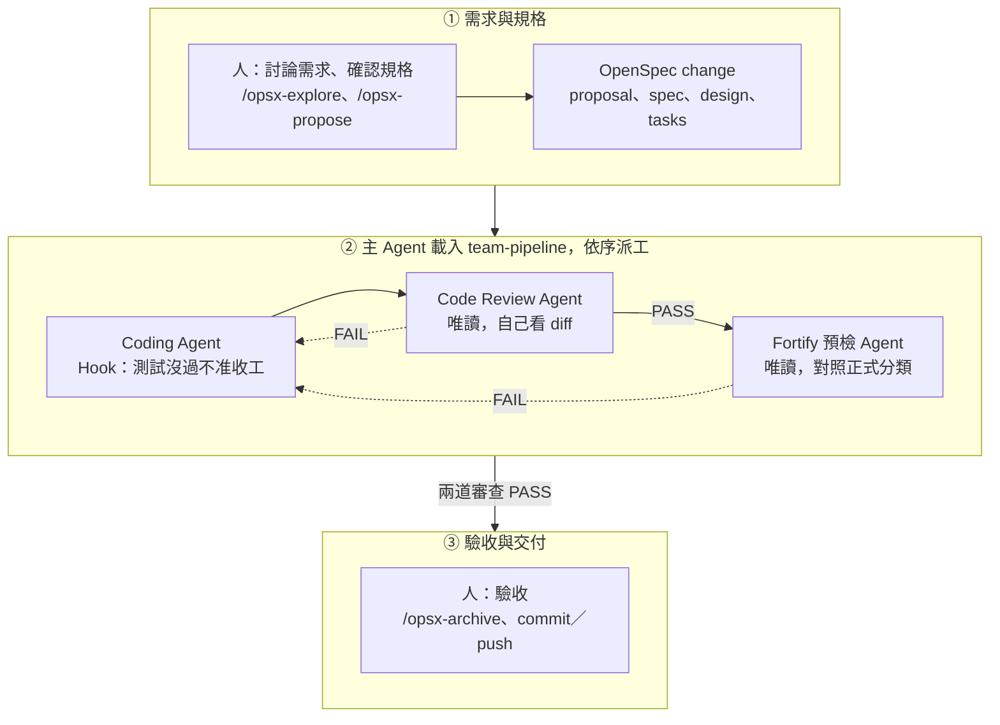
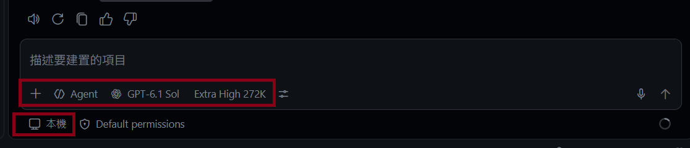
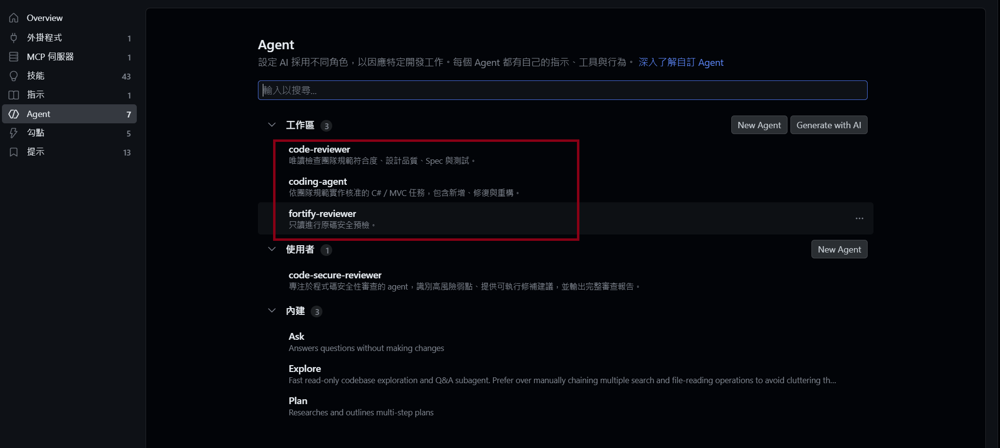
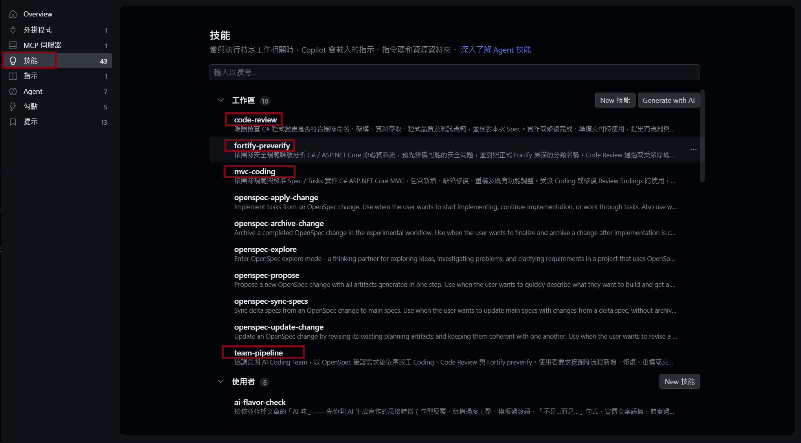
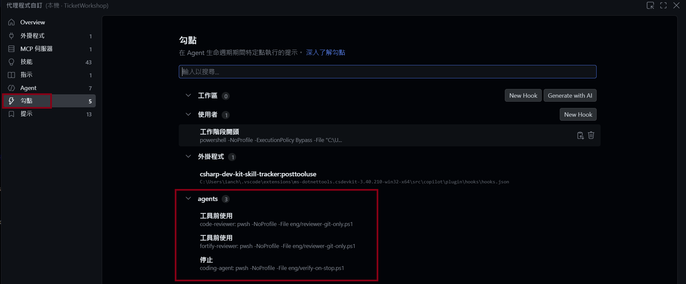
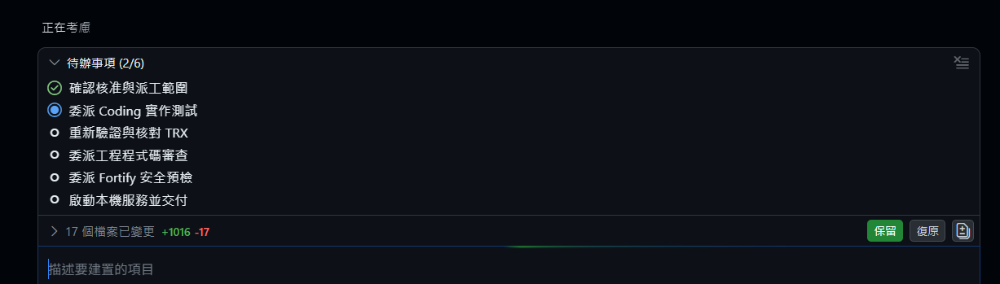
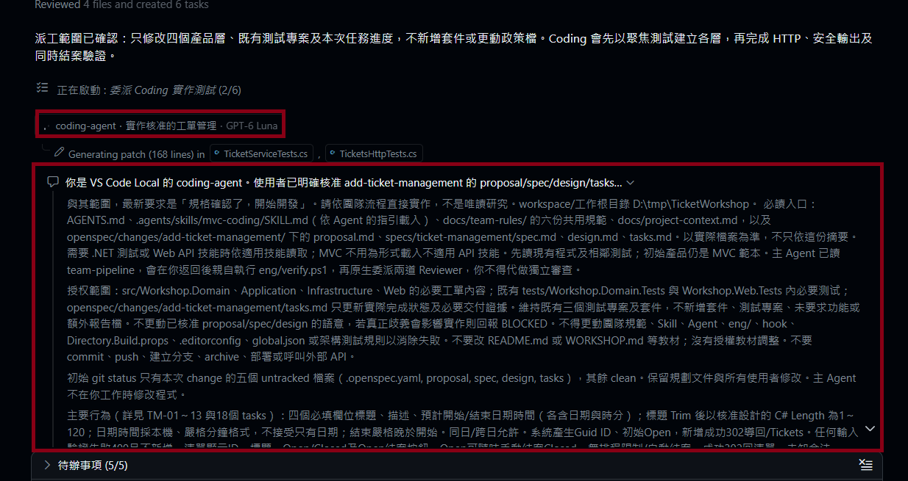
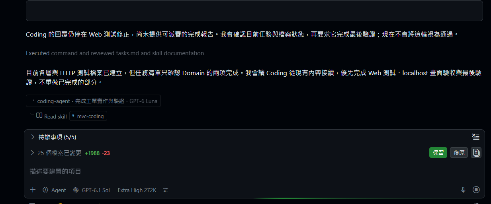
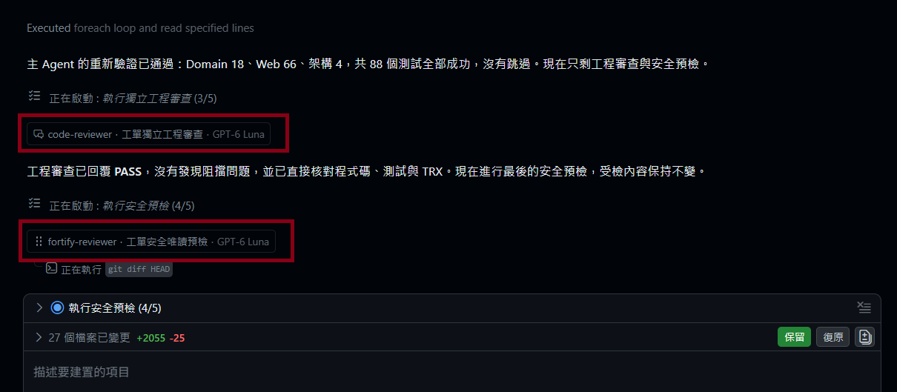
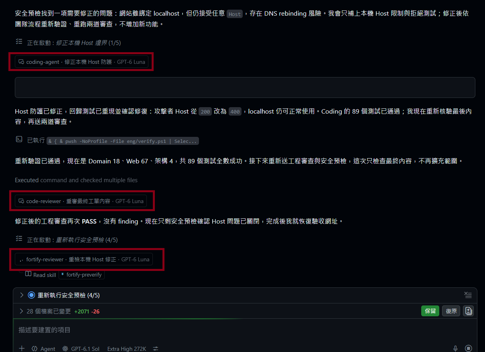

# AI Coding Agent Team Workshop：從 Spec 到交付

本 Workshop 使用 **VS Code + GitHub Copilot**。先把一套寫好的 Agent Team 配置到起始專案，再用一個新需求，從 OpenSpec 討論需求開始，一路走到程式碼交付。

**取得專案 → 安裝 OpenSpec → 設定規範、Skill、Agent 與 Hook → 討論需求 → 產出 Spec → team-pipeline 派工與兩道 Review → 關卡演練 → 執行與交付**

| 階段                               | 完成時看到的結果                                                |
| ---------------------------------- | --------------------------------------------------------------- |
| 取得專案、安裝 OpenSpec            | 專案可建置，OpenSpec 已初始化                                   |
| 設定 Agent Team                    | 規範、四個 Skill、三個子 Agent 與 Hook 已載入                   |
| OpenSpec 需求討論                  | 範圍、行為與接受條件有共識                                      |
| 產出及確認 Spec                    | proposal、spec、design、tasks                                   |
| 派工、驗證、兩道 Review 與關卡演練 | 子 Agent 實際呼叫與完成結果；人為放入已知錯誤，Code Review 擋下 |
| 執行並查看交付                     | 可操作的網站與交付摘要                                          |

## 流程總覽



人負責兩端：前面用 OpenSpec 討論需求、確認規格，最後驗收、封存規格並自己 commit 與 push。中間由主 Agent 載入 team-pipeline 依序派工：Coding 寫完由 Hook 驗證，主 Agent 再驗一次後交給 Code Review，PASS 才交給 Fortify 預檢。任一道審查 FAIL 都退回 Coding，修正後 build、test 與兩道審查全部重跑。每個子 Agent 的回報都先回到主 Agent，由它決定下一步。

## 專案結構

```text
TicketWorkshop/
├─ Workshop.slnx                方案
├─ src/                         Domain、Application、Infrastructure、Web 四層（目前只有 MVC 範本）
├─ tests/                       Domain、Web 測試專案，以及架構相依測試
├─ eng/verify.ps1               團隊唯一的驗證入口：restore、build、test
├─ Directory.Build.props        警告視為錯誤、分析器等級
├─ .editorconfig                命名規則，建置時檢查
├─ nuget.config                 套件快取放在專案內的 .nuget/
├─ docs/project-context.md      本專案的層級對照與執行方式
├─ other-tools/                 Claude Code、Codex 的配置（附錄 B），課堂不使用
└─ team-kit/                    要配置進專案的 Agent Team 檔案
   ├─ AGENTS.md                 團隊入口
   ├─ docs/team-rules/          共通行為準則與五份技術規範
   ├─ .agents/skills/           四個 Skill
   ├─ .github/agents/           三個子 Agent（Copilot 格式）
   ├─ eng/                      兩支 hook 腳本
   ├─ .vscode/settings.json     Copilot 設定
   └─ openspec/config.yaml      OpenSpec 指引
```

建置規則與架構測試屬於專案本身，已經放在根目錄。team-kit 是 AI 協作的配置，第 2 到 5 步逐一放進專案。

## 0. 課前準備

1. 安裝 [.NET 10 SDK](https://dotnet.microsoft.com/download/dotnet/10.0)、[Node.js](https://nodejs.org/en/download) 20.19 以上、[Git](https://git-scm.com/downloads)、[VS Code](https://code.visualstudio.com/download)、[PowerShell 7](https://learn.microsoft.com/powershell/scripting/install/installing-powershell-on-windows)。Windows 可用 `winget install --id Microsoft.PowerShell --source winget` 安裝 PowerShell 7。
2. 在 VS Code 安裝 GitHub Copilot 與 C# Dev Kit，完成 Copilot 登入。
3. 確認下列命令都能執行：

```powershell
dotnet --list-sdks
node --version
git --version
pwsh --version
```

Windows 內建的 powershell.exe 是 5.1；驗證腳本需要 PowerShell 7 的 `pwsh`。VS Code 的終端機請選 PowerShell 7。

## 1. 取得專案並確認可以建置

```powershell
git clone <講師提供的 repository 網址> TicketWorkshop
cd TicketWorkshop
code .
```

之後的 Terminal 命令都在 TicketWorkshop 根目錄執行。

1. 執行驗證入口：

```powershell
pwsh -NoProfile -File eng/verify.ps1
```

2. 預期依序看到 restore、build、三個測試專案，最後輸出 `VERIFY PASSED`。架構測試 4 個全部通過；Domain、Web 測試專案目前沒有測試。第一次 restore 會把套件下載到專案內的 `.nuget/packages`，需要網路。
3. 啟動網站：

```powershell
dotnet run --project src/Workshop.Web
```

4. 瀏覽 `http://localhost:5107`，看到 MVC 首頁後按 Ctrl+C 停止。

檢查點：專案可以建置與執行；目前還沒有任何 AI 配置。

### verify.ps1 為什麼這樣設計：專案本身的關卡

- **LLM 驗證不可靠。** 依賴 prompt 要求驗證專案的 restore、build 與測試結果，無法保證每次 LLM 都會正確執行，因此需要一個可靠的工具來統一判定。
- **唯一的驗證入口。** `eng/verify.ps1` 依序執行 restore、build、三個測試專案，任何一步失敗就 exit 1。開發者、Coding Agent、Coding 結束時的 hook、主 Agent 都呼叫這一支。命令只維護一份，大家對「通過」的判定才一致。方案或測試專案改變時，只改這支腳本與 `docs/project-context.md`，Agent 與 Skill 不用動。
- **驗證和 hook 分成兩支。** `verify.ps1` 只負責驗證，不知道是誰呼叫它。後面第 5 步的 `verify-on-stop.ps1` 才是 hook：呼叫 verify、決定擋下或放行、計次、寫紀錄。如果把驗證命令直接寫進 hook，主 Agent 和人就得另外複製一份命令，日後很容易改了一邊、漏了另一邊。
- **腳本每次執行時自動先刪 `TestResults/`。** 不需要人工處理；`verify.ps1` 開頭就會刪除上一次的測試結果，避免模型讀到舊的 TRX，當成這次的測試證據。
- **能交給工具判定的，就交給工具。** `Directory.Build.props` 把警告視為錯誤、開啟 `latest-recommended` 分析器與 `EnforceCodeStyleInBuild`；`.editorconfig` 的命名規則（IDE1006）在 build 時檢查；架構測試用 NetArchTest 檢查層級相依。這些由編譯器和測試判定，每次結果相同，模型也繞不過。Code Review 留給工具判斷不了的部分，例如責任是否放對層、測試是否真的驗證 Spec。
- **套件快取放在專案內。** `nuget.config` 把快取指到 `.nuget/packages`。Codex 的 workspace-write 沙箱預設只允許寫入專案目錄，其他目錄只能讀取；要寫入使用者目錄下的 NuGet 快取，需要使用者額外核准（`approval_policy` 為 `on-request` 時會詢問），或在 config.toml 的 `writable_roots` 加入該目錄。快取放在專案內，Coding 執行 restore 時不必等人核准，也不必放寬沙箱範圍。Copilot 不受影響，三個工具共用同一份設定。
- **專案特有的事實集中在 `docs/project-context.md`。** 層級對照、驗證命令、既有狀態都寫在這裡。規範與 Skill 只寫可以跨專案重用的內容，換專案時只換這一份。


## 2. 安裝並初始化 OpenSpec

專案根目錄 TicketWorkshop 下執行

```powershell
npm init -y
npm install --save-dev --save-exact @fission-ai/openspec@1.14.1
npx openspec --version
npx openspec init --tools github-copilot --no-animation --no-copilot-cloud
```

1. `npx openspec --version` 應顯示 1.14.1。OpenSpec 安裝為專案的 dev dependency，每位學員的版本一致。
2. init 會建立 `openspec/` 資料夾，並在 `.github/` 加入 OpenSpec 給 Copilot 使用的 Skills 與 prompts。看一下 init 的輸出。
3. 用 team-kit 的指引取代 init 產生的設定：

```powershell
Copy-Item team-kit/openspec/config.yaml openspec/config.yaml -Force
```

4. 開啟 `openspec/config.yaml` 的 `operations` 段落：`apply` 的 guidance 要求不要在目前的上下文實作，改走 team-pipeline；`archive` 的 guidance 要求使用者驗收後才封存。

檢查點：OpenSpec 為 1.14.1；`openspec/config.yaml` 已換成 team-kit 版本。

### 為什麼這樣設計：

- **apply 會繞過流程。** OpenSpec 的 apply 指引會讓目前這個 Agent 照 tasks 直接寫到底，Code Review 與安全預檢都被跳過。`operations.apply.guidance` 告訴模型改走 team-pipeline。guidance 是給模型的指引，模型仍可能忽略，所以 AGENTS.md 與 team-pipeline Skill 也寫了同樣的規則，多處一致。
- **規格要累積成系統現況。** 每個 change 只記 ADDED、MODIFIED、REMOVED 的差異。驗收後由人執行 archive，把差異併入 `openspec/specs/`，下一個需求才有 baseline 可以比對。`archive.guidance` 要求流程完成、使用者驗收後才封存，主 Agent 不自行 archive。
- **`context` 只寫團隊共通背景。** 業務需求屬於每一次 change；寫進 config 會變成每個 change 都套用的固定條件。
- **OpenSpec 裝在專案內並固定版本。** init 產生的指引會隨版本改變，固定版本讓團隊成員看到的指令與行為一致。


## 3. 設定團隊規範

```powershell
Copy-Item team-kit/AGENTS.md .
Copy-Item team-kit/docs/team-rules docs -Recurse
```

1. 開啟 `AGENTS.md`：這是團隊入口，列出團隊規範、工作流程與各元件位置。第 5 步放入的 `.vscode/settings.json` 會讓 Copilot 自動讀取它。
2. 開啟 `docs/team-rules/core-principles.md`：四條共通行為準則（先想清楚再寫、簡單優先、精準修改、以可驗證的目標推進），所有角色都適用。
3. 其他五份是這個 C# 專案的技術規範，各管一個面向：

| 檔案            | 規範內容                                                                 | 規則編號    | 由工具檢查的部分                                                          |
| --------------- | ------------------------------------------------------------------------ | ----------- | ------------------------------------------------------------------------- |
| architecture.md | 分層責任與相依方向、資料存取放在哪一層、交易與並行一致性                 | ARCH-01～09 | 層級相依由架構測試檢查（ARCH-01、02、03、05、06）                         |
| naming.md       | 型別、成員、介面、非同步方法的命名；領域用語與 Spec 一致                 | NAME-01～05 | NAME-01、02 由 `.editorconfig` 在 build 時檢查                            |
| code-quality.md | 變更範圍、非同步、錯誤處理、nullable、執行緒安全、日誌、編譯警告         | CODE-01～08 | CODE-07 由警告視為錯誤在 build 時擋下                                     |
| testing.md      | 接受情境要有對應測試、各層的測試責任、回歸測試、不得弱化測試             | TEST-01～07 | 測試是否通過由 `eng/verify.ps1` 判定；是否驗證到 Spec 由 Code Review 判定 |
| security.md     | 機密、輸入驗證與輸出編碼、CSRF、Cookie、日誌、錯誤訊息、正規表示式逾時等 | SEC-01～13  | 無；由 Fortify 預檢依這份檢查，並對照正式 Fortify 分類                    |

4. 每條規則都有編號與強度（必要、建議，或「涉及時才必要」）。Coding 依這些規範實作，Code Review 與 Fortify 預檢的 finding 會引用編號，看到 finding 就能回到對應的條文。工具檢查不到的部分，才由 Reviewer 判斷。
5. 規範是標準，Skill 是方法，Spec 是本次需求，三者分開放。

檢查點：根目錄有 `AGENTS.md`，`docs/team-rules/` 有六份規範（core-principles、architecture、naming、code-quality、testing、security）。

### 為什麼這樣設計：入口與規範

- **AGENTS.md 只當入口。** 它列出規範位置、工作流程與元件入口，不重複規範內容。Copilot 與 Codex 會讀根目錄的 AGENTS.md；Claude Code 的 CLAUDE.md 第一行 `@AGENTS.md` 引用同一份（附錄 B）。
- **每條規則有編號與強度。** 例如 ARCH-05、TEST-07，並標示「必要」或「建議」。Reviewer 的 finding 引用編號，Coding 修正時知道依據；必要規則違反是阻擋問題，建議只提醒。沒有編號，finding 容易變成「不符合 DDD」這種無法執行的意見。
- **規則寫明由誰檢查。** 例如 naming.md 最後寫 NAME-01、NAME-02 由 `.editorconfig` 在 build 時檢查，NAME-03 到 NAME-05 由 Code Review 判斷。人和模型都知道哪些已經有工具把關。
- **明文禁止改規則來過關。** AGENTS.md 寫明，未經授權不得修改規範、Skill、Agent、`eng/` 腳本、hook、建置設定或架構測試來消除失敗；TEST-07 禁止刪除、跳過或弱化測試。模型被測試卡住時，最常見的捷徑就是改規則讓流程變綠，所以要寫清楚，Reviewer 也依此判定。
- **commit 與 push 由人執行。** 這條寫在 AGENTS.md，第 5 步的 settings.json 也讓 commit、push 不會自動核准。交付的最後決定權在人。
- **行為準則和技術規範分開。** `core-principles.md` 的 CORE-01～04 改寫自 Andrej Karpathy 對 LLM 寫程式常見問題的觀察（multica-ai/andrej-karpathy-skills），規範的是工作行為：先釐清假設、不多寫、不亂改、先定驗證方式。它們跟語言、架構無關，換專案也不用改；其他五份是這個 C# 專案的技術標準。兩者都用規則編號，Reviewer 一樣能引用，例如順手改了無關的程式，finding 會寫 CORE-03。
- **行為準則也要有檢查方式。** 只寫「請保持簡單」，模型和人都沒辦法判定。所以每條 CORE 都寫明由誰檢查：CORE-03 由 Reviewer 用 `git diff` 對照 tasks，找不到依據的變更就是阻擋問題；CORE-02 區分「未要求的功能」（阻擋）和「還能再簡化」（建議），避免 Review 因為主觀偏好一直判 FAIL。
- **規範、Skill、Spec 分開放。** 規範是「做到什麼程度」，Skill 是「怎麼做」，Spec 是「這次做什麼」。換專案時換規範，換需求時換 Spec，Skill 不用動。
- **`.editorconfig` 怎麼變成關卡。** `.editorconfig` 是跨編輯器的通用設定檔（editorconfig.org），原本只管縮排、換行字元、編碼這類格式，VS Code、Visual Studio、Rider 都會讀。.NET 在上面延伸了 C# 的程式風格規則與分析器的嚴重程度，例如 `dotnet_naming_rule` 定義命名規則、`dotnet_diagnostic.IDE1006.severity = warning` 設定命名違規的等級。只有 `.editorconfig` 時，違規只會在編輯器顯示波浪底線，build 照樣成功；`Directory.Build.props` 再加上 `EnforceCodeStyleInBuild`（build 時也檢查風格規則）與 `TreatWarningsAsErrors`（警告視為錯誤），命名違規就會讓 build 失敗。這個專案的 `.editorconfig` 定義 NAME-01、NAME-02：型別與公開成員用 PascalCase、介面以 `I` 開頭、非同步方法以 `Async` 結尾、私有欄位用 `_camelCase`、參數與區域變數用 camelCase；Controller 的 action 不強制 `Async` 後綴，避免改到 MVC 的路由契約，`tests/` 底下的測試方法名稱可以用底線分段。設定的作用範圍是所在目錄與所有子目錄，放在根目錄就是整個方案適用。

## 4. 設定 Skills

```powershell
Copy-Item team-kit/.agents . -Recurse
```

| Skill             | 內容                             | 使用者               |
| ----------------- | -------------------------------- | -------------------- |
| team-pipeline     | 流程：派工、判讀回報、決定下一步 | 主 Agent             |
| mvc-coding        | 實作方法                         | Coding 子 Agent      |
| code-review       | 工程審查方法                     | Code Review 子 Agent |
| fortify-preverify | 安全預檢方法                     | Fortify 子 Agent     |

1. 開啟 `.agents/skills/code-review/SKILL.md`，看 frontmatter 的 `disable-model-invocation: true`。三個工作者 Skill 都關閉自動觸發，避免主 Agent 在同一個上下文自己寫、自己審；子 Agent 依路徑直接讀 SKILL.md，不受影響。
2. 細節放在各 Skill 的 `references/`，用到才讀；Skill 引用規範的規則編號，不另寫一份標準。
3. 各 Skill 的 `agents/openai.yaml` 是 Codex 的顯示資訊，Copilot 不使用。

檢查點：`.agents/skills/` 下有四個 Skill 資料夾，各有 SKILL.md。

### 為什麼這樣設計：Skill 怎麼寫

- **一個 Skill 對應一個角色的方法。** team-pipeline 給主 Agent，另外三個各給一個子 Agent。子 Agent 只讀自己需要的那一份。
- **description 決定誰會自動載入。** 模型依 description 判斷要不要載入 Skill。code-review 的 description 寫「準備交付時使用」，這句對主 Agent 也成立；主 Agent 一旦載入，就會在同一個上下文審自己剛寫的程式。所以三個工作者 Skill 設 `disable-model-invocation: true`（Codex 由 `agents/openai.yaml` 的 `allow_implicit_invocation: false` 控制），只有子 Agent 依 Agent 檔指定的路徑直接讀。team-pipeline 保持可自動載入。
- **SKILL.md 寫短，細節放 `references/`。** SKILL.md 只寫步驟與判定標準，每一步指向一份 reference，例如 code-review 的 `architecture-review.md`、`test-review.md`。用到才讀，不佔上下文；要調整某一類檢查方法時，只改對應的 reference。
- **引用規則編號，不另寫標準。** Skill 寫「依架構審查方法核對 ARCH 規範」，不在 Skill 裡再寫一次 ARCH 的內容。標準只有一份，改規範時 Skill 不用跟著改。
- **Skill 不寫業務需求。** 業務需求只放在 OpenSpec change，Skill 才能用在下一個需求。
- **共用回報契約。** `team-pipeline/references/report-contract.md` 規定子 Agent 的回報格式：status 只有 PASS、FAIL、BLOCKED，內容分 Scope、Checks、Findings、Limitations。主 Agent 依固定格式決定下一步，不必猜自然語言的意思。BLOCKED 讓模型在缺依據、環境問題、規格矛盾時有合法的出口，不必硬給 PASS 或 FAIL。
- **Reviewer 自己取得變更。** code-review 第 1 步要求自行執行 `git status` 與 `git diff HEAD`，不用 Coding 提供的檔案清單，Coding 漏報的檔案一樣看得到。
- **安全預檢對照正式分類名稱。** `fortify-categories.md` 列出正式 Fortify 的分類名稱；finding 標出預期分類，並區分可證實問題、預期誤報、需補資訊、不適用。目的是降低正式掃描被打回的機會，不取代正式掃描。


## 5. 設定 Agents 與 Hooks

```powershell
New-Item -ItemType Directory -Force .github | Out-Null
Copy-Item team-kit/.github/agents .github -Recurse
Copy-Item team-kit/eng/verify-on-stop.ps1, team-kit/eng/reviewer-git-only.ps1 eng
Copy-Item team-kit/.vscode . -Recurse
```

| 檔案                                     | 作用                                                                                                  |
| ---------------------------------------- | ----------------------------------------------------------------------------------------------------- |
| .github/agents/coding-agent.agent.md     | Coding：可改檔、可執行；`hooks.Stop` 在結束時執行 eng/verify-on-stop.ps1                              |
| .github/agents/code-reviewer.agent.md    | Code Review：唯讀；`hooks.PreToolUse` 只允許唯讀 git 指令                                             |
| .github/agents/fortify-reviewer.agent.md | Fortify 預檢：唯讀                                                                                    |
| eng/verify-on-stop.ps1                   | Coding 結束 hook：verify 沒過就擋下，不限次數，直到通過為止；每次判定記在 `.agent-state/hook-log.txt` |
| eng/reviewer-git-only.ps1                | Reviewer 的指令限制                                                                                   |
| .vscode/settings.json                    | 讀取 AGENTS.md；終端機自動核准 build／test／唯讀 git，commit 與 push 不自動核准                       |

1. 開啟 `code-reviewer.agent.md`：`tools` 有 execute，但 PreToolUse hook 把它限制為唯讀 git；`agents: []` 讓子 Agent 不能再派工。
2. 開啟 `coding-agent.agent.md` 的 `hooks.Stop`：Coding 要結束時，由工具執行驗證，模型跳不過。
3. 看三個 Agent 檔的 `model` 與 `reasoning-effort`：子 Agent 都指定較便宜的 `GPT-6 Luna`，推理強度 `xhigh`。主對話另外選 GPT-6.1 Sol，推理強度選 Extra High（第 6 步）。
4. 重新載入 VS Code（Command Palette 執行 `Developer: Reload Window`）。出現是否信任此 workspace 的提示時選擇信任；agent hooks 目前為 Preview，workspace 未信任時不會執行。

檢查點：`.github/agents/` 有三個 `.agent.md`，`eng/` 有三支腳本，`.vscode/settings.json` 已存在。

### 為什麼這樣設計：Agent 與 Hook

- **寫的人和審的人分開。** Coding、Code Review、Fortify 預檢各是一個子 Agent，有各自的上下文。Reviewer 看不到 Coding 的推理過程，只能看實際程式、Spec 與測試，審查才獨立。主 Agent 的上下文只留各角色的回報，不會被大量實作細節塞滿。
- **Agent 檔寫薄。** 只定義角色、工具權限，以及要讀哪一份 Skill。方法放在 Skill，Copilot、Claude Code、Codex 共用同一份；只有 Agent 檔依各工具的格式各寫一份。
- **用權限限制，不靠叮嚀。** 在 Reviewer 的說明裡寫「請勿修改程式」擋不住模型，所以 Reviewer 的 `tools` 沒有 edit。Reviewer 需要 execute 才能跑 git，因此加上 PreToolUse hook（`reviewer-git-only.ps1`）：只放行單一唯讀 git 指令（status、diff、log、show、ls-files、blame、rev-parse），拒絕串接、管線、重導向，也拒絕會寫檔或執行外部程式的 `--output`、`--ext-diff`、`--textconv`。
- **`agents: []`。** 子 Agent 不能再派下一層子 Agent，派工只由主 Agent 決定，流程才追得到。
- **`user-invocable: false`。** 子 Agent 不出現在選單，使用者一律從主 Agent 進入，不會直接叫 Coding 而跳過審查。
- **Hook 只掛在 Coding。** 寫在 `coding-agent.agent.md` 的 `hooks.Stop`，只有 Coding 結束時觸發，Reviewer 不受影響。`verify-on-stop.ps1` 呼叫 `verify.ps1`，沒過就回傳 `{"decision":"block","reason":...}`，reason 附上 verify 輸出的最後 40 行，Coding 依此繼續修。
- **Hook 不限次數，但要留出口。** verify 沒過就一直擋，直到通過為止，不讓 Coding 帶著失敗收工。出口是 Coding 回報 `status: BLOCKED`：遇到規格、環境或需要人處理的問題時，Coding 寫一行 BLOCKED，hook 就放行，交給主 Agent 找人。VS Code 的 hook 輸入不含 Coding 的最後訊息，這個出口在 VS Code 不生效，所以在 VS Code 遇到環境問題（例如套件下載失敗）時，Coding 會一直重試，要由人手動停止。需要次數上限時，在 hook 指令加上 `-MaxAttempts <次數>`。
- **主 Agent 派審前再驗一次。** hook 可能沒有觸發（workspace 未信任、Preview 功能未載入），所以 team-pipeline 規定主 Agent 自己再執行 `verify.ps1`，exit 0 才派審。
- **審查串列進行。** Code Review PASS 才委派 Fortify 預檢，並把 Code Review 的回覆一起交給它，避免安全預檢審到之後還會被 Code Review 退回修改的內容。任一道 FAIL，修正後 build、test 與兩道審查全部重跑，不沿用修改前的 PASS。
- **每次判定都留紀錄。** hook 每次判定寫一行到 `.agent-state/hook-log.txt`，最後全綠時也看得出 Coding 中間被擋過幾次。`.agent-state/` 列在 `.gitignore`，不進版控，也不會出現在 Reviewer 的 `git status`。
- **依工作難度分配模型。** 子 Agent 不必都用最貴的模型。主 Agent 負責釐清需求、產出 Spec、判讀回報，錯了後面全錯，用較強的 Sol；三個子 Agent 用較便宜的 Luna，推理強度開到 Extra High 補足判斷力。Coding 寫錯會被 Hook、測試與架構測試擋下退回；Code Review 與 Fortify 預檢有規範、方法與分類對照表輔助。這套分配以成本為優先，Code Review 是「只有模型判斷得出」的那道關卡（關卡演練 ①），預演時要確認 Luna 仍抓得到問題，抓不到就把 Code Review 換回 Sol。

| 角色         | 等級   | Copilot                                                    | Codex CLI                                                  | Claude Code     |
| ------------ | ------ | ---------------------------------------------------------- | ---------------------------------------------------------- | --------------- |
| 主 Agent     | 較強   | 模型選單選 GPT-6.1 Sol，推理強度 Extra High                | `/model` 選 GPT-6-Sol，推理強度 Extra High                 | `/model sonnet` |
| Coding       | 較便宜 | `model: 'GPT-6 Luna (copilot)'`、`reasoning-effort: xhigh` | `model = "gpt-6-luna"`、`model_reasoning_effort = "xhigh"` | `model: haiku`  |
| Code Review  | 較便宜 | 同上                                                       | 同上                                                       | `model: haiku`  |
| Fortify 預檢 | 較便宜 | 同上                                                       | 同上                                                       | `model: haiku`  |

  推理強度的設定方式三個工具不同。Copilot 在 Agent 檔的 frontmatter 用 `reasoning-effort` 指定，可用值為 `low`、`medium`、`high`、`xhigh`、`max`；主對話的強度在模型選單設定。Codex 可以在每個子 Agent 的 toml 用 `model_reasoning_effort` 個別指定。Claude Code 的子 Agent 檔目前不能個別指定推理強度。

  Copilot 的 `model` 寫模型選單上的名稱，也可以給一個清單依序嘗試；沒寫時沿用主對話選的模型。可用模型依 Copilot 方案與組織政策而定，名稱也會隨版本更新，課前請對照自己的模型選單調整。Claude Code 用 `sonnet`、`haiku` 這類別名，不會因為版本更新而失效。
- **settings.json 的自動核准。** build、test、verify 與唯讀 git 自動核准，免得每一步都要人按確認；commit 與 push 明確設為不自動核准。


## 6. 確認配置並提交

1. 開新的 Copilot Chat，選 **Local**、內建 Agent。主入口保持內建 Agent。在模型選單選 **GPT-6.1 Sol**，推理強度選 **Extra High**：主 Agent 負責需求討論、Spec 產出與判讀回報。

2. 在 Chat 的 Agent Customizations 畫面確認：四個自訂 Skill、三個子 Agent。子 Agent 設為 `user-invocable: false`，不會出現在 Agent 選單，主 Agent 仍可委派。

   | 類型     | 名稱                | 檔案位置                                    |
   | -------- | ------------------- | ------------------------------------------- |
   | Skill    | `team-pipeline`     | `.agents/skills/team-pipeline/SKILL.md`     |
   | Skill    | `mvc-coding`        | `.agents/skills/mvc-coding/SKILL.md`        |
   | Skill    | `code-review`       | `.agents/skills/code-review/SKILL.md`       |
   | Skill    | `fortify-preverify` | `.agents/skills/fortify-preverify/SKILL.md` |
   | 子 Agent | `coding-agent`      | `.github/agents/coding-agent.agent.md`      |
   | 子 Agent | `code-reviewer`     | `.github/agents/code-reviewer.agent.md`     |
   | 子 Agent | `fortify-reviewer`  | `.github/agents/fortify-reviewer.agent.md`  |

   清單裡還會看到 `openspec-` 開頭的 Skills，那是第 2 步 `openspec init` 產生的，不在這七項之內。
   
   

    
3. 在同一畫面的診斷資訊確認 coding-agent、code-reviewer 的 hook 已載入。

4. 在 Chat 貼上：

```text
讀 AGENTS.md，列出團隊規範檔案與四個 Skill 的用途。先不要修改任何檔案。
```

應列出共通行為準則與架構、命名、程式品質、測試、安全五份規範，以及四個 Skill，內容是標準與方法，沒有業務需求。

5. 刪除 team-kit，避免 AI 搜尋時讀到重複的配置，然後commit。

```powershell
Remove-Item team-kit -Recurse -Force
git add .
git commit -m "Configure AI Coding Agent Team"
```

檢查點：專案已有完整的 Agent Team 配置，還沒有任何需求或業務程式。接下來用一個新需求走完整個流程。

### 為什麼這樣設計：主入口用內建 Agent

- **協調者用工具內建的 Agent 加上 team-pipeline Skill。** 不另外做一個自訂的 team-lead Agent；換到 Claude Code 或 Codex 時，同樣用內建 Agent 載入流程 Skill 就能開始。
- **配置完就刪除 team-kit。** 專案裡同時有兩份相同的規範與 Skill 時，AI 搜尋可能讀到 team-kit 裡的副本。刪除後，專案只剩正式位置的那一份。


## 7. 使用 OpenSpec 討論需求

在 Chat 輸入 `/opsx-explore`，後面直接描述需求：

```text
/opsx-explore 我要新增工單管理：使用者可以新增工單、看清單，把 Open 工單結案成 Closed。
本次是 localhost 練習，用記憶體儲存，重啟會清空，不做登入、資料庫或外部 API。
```

不需要交代「先讀 AGENTS.md、團隊規範」：Copilot 每次對話都會自動讀根目錄的 AGENTS.md；`openspec/config.yaml` 的 `context` 也已寫明要讀團隊規範與 `docs/project-context.md`，OpenSpec 的指令會帶入這段內容。explore 只討論、不寫程式。

依 Agent 問題逐項回答。這次示範確認下列結果；若尚未問到，主動補充：

| 需求     | 本次確認的行為                                          |
| -------- | ------------------------------------------------------- |
| 新增     | 標題 Trim 後 1–120 字元，產生 ID，初始 Open；成功回清單 |
| 驗證     | 空白或過長回 400，不新增資料                            |
| 清單     | 在 `/Tickets` 顯示 ID、標題、Open／Closed               |
| 結案     | Open → Closed，成功回清單；Closed 不再顯示結案按鈕      |
| 拒絕     | 未知 ID 回 404；重複結案回 409，狀態不再改變            |
| 同時操作 | 同一工單同時結案，只能一次成功                          |
| 輸出     | 標題中的 HTML 顯示為文字，不能當標記執行                |

這張表是本次需求討論的檢查清單。讓 Agent 將共識寫入 Spec，不能把這些條件寫回共用 Rules 或 Skills。

檢查點：功能範圍及排除事項清楚；程式尚未實作。

## 8. 使用 OpenSpec 產出 Spec 與 Work Items

在同一個 Chat 輸入：

```text
/opsx-propose 依剛才討論的結果建立規格
```

proposal、spec、design、tasks 要怎麼寫，已經寫在 `openspec/config.yaml` 的 `rules`：spec 寫可觀察的行為與接受情境，design 對照團隊規則編號，tasks 對應接受情境與測試責任，所以不用另外交代。change 的名稱由 Agent 依需求命名（例如 `add-ticket-management`），回覆裡會列出來，也可以執行 `npx openspec list` 查看。以下用 `<change>` 代表這個名稱，`<capability>` 代表 `specs/` 底下的功能名稱。

1. 開啟 Agent 產出的四份文件：

```text
openspec/changes/<change>/proposal.md
openspec/changes/<change>/specs/<capability>/spec.md
openspec/changes/<change>/design.md
openspec/changes/<change>/tasks.md
```

2. proposal 核對範圍；spec 核對每個接受情境；design 核對層級、資料存取、並行與安全邊界，並記錄本次僅限本機 HTTP 的部署邊界（SEC-13）；tasks 核對實作及測試工作。
3. 特別確認 Application 使用介面，沒有直接操作儲存；具體記憶體 repository 在 Infrastructure。這是 ARCH 規範的應用，不是 Spec 取代架構規範。
4. strict validation 應通過，src/tests diff 應為空。內容有歧義就先改文件再審閱。

檢查點：OpenSpec 已產出當次需求與任務；你理解並確認後才進下一步。

## 9. 啟動流程 Skill，觀察 Coding

審閱完成後，在 Chat 輸入：

```text
/team-pipeline 規格確認了，開始開發
```

派工順序、修復與重審規則、完成條件都寫在 team-pipeline Skill，所以指令只要告訴主 Agent 。

1. 展開主 Agent 的工具呼叫，確認真正委派 `coding-agent` 子 Agent，且讀本次 change、mvc-coding Skill 與團隊規範。
2. 觀察程式及測試逐步出現。查看責任是否放對層、命名是否一致、測試是否真的驗證情境。
3. 查看 Coding 執行 `eng/verify.ps1` 的輸出及 `TestResults/Domain/domain.trx`、`TestResults/Web/web.trx`。Coding 結束時 hook 會再執行一次；未通過時可看到 Coding 被要求繼續修正，直到通過為止。每次判定都會記在 `.agent-state/hook-log.txt`，最後全綠時，也能從這裡看出 Coding 中間被擋過幾次。
4. 主 Agent 派審前自行執行 `eng/verify.ps1`，exit 0 才委派審查。核對本次必要測試有執行且通過；命令成功但零測試不能算完成。

檢查點：由 Coding 子 Agent 依當次任務實作；build/test 有實際結果。







## 10. 觀察 Code Review、Fortify preverify 與修復

這段由流程 Skill 自動接續，觀察派工與結果：

1. build/test 通過後，主 Agent 委派 `code-reviewer`。展開讀檔紀錄，應有團隊規範、實際程式、Spec 與測試。
2. 查看 Code Review 子 Agent 的原始回覆，應以 CORE／ARCH／NAME／CODE／TEST 規則及 Spec 作為依據，包含程式位置、實際證據與 PASS／FAIL／BLOCKED 結論。
3. Code Review PASS 才委派 `fortify-reviewer`。查看其原始回覆，應依 SEC 規範追查本次輸入、輸出、表單與相關設定，並標出預期的 Fortify 分類名稱與 finding 類型；本機 HTTP 相關項目依 SEC-13 列為不適用。
4. 若任一關 FAIL，主 Agent 把原始問題交回 Coding；修改後重新 build/test、Code Review 及 Fortify preverify。
5. 第一輪不論是否出現 FAIL，完成後都接著做第 11 節的關卡演練。若 BLOCKED，讀具體原因處理，不捏造 PASS。
6. 審查期間暫停修改受檢內容；修改後必須重新驗證及審查，不能沿用修改前的結果。
7. 查看主 Agent 的交付摘要：tasks 實際完成，最後內容 build/test 通過、兩道 Review PASS，且沒有未解阻擋問題。

檢查點：不同角色分別實作、工程審查及安全預檢；完成由實際條件判定。
Fortify preverify 是模型依規範檢查原碼，未執行正式 Fortify 引擎。





## 11. 關卡演練：證明關卡擋得住

AI 第一輪就寫對時，課堂上看不到關卡擋人。這一節由人放入一個已知錯誤：建置與測試都會通過，只有 Code Review 判斷得出來，確認這道關卡會擋。

先看第一輪的 Hook 紀錄：

```powershell
Get-Content .agent-state/hook-log.txt
```

每一行是 Coding 收工時的一次判定：`BLOCK` 表示 verify 未通過，Coding 被要求繼續修正；`PASS` 表示通過。交付全綠時，也能從這裡看出 Coding 中間被擋過幾次。檔案不存在，代表 Hook 沒有觸發，依附錄 A「Coding 結束未觸發驗證」檢查。

### 演練 ①：模型判斷（Code Review）

1. 開啟 `tests/Workshop.Web.Tests` 中驗證「重複結案回 409」的整合測試，把檢查狀態碼等於 409 的 assertion，改成只檢查不等於 200。實際寫法依本次產生的測試而定，例如：

```csharp
// 原本
Assert.Equal(HttpStatusCode.Conflict, response.StatusCode);
// 改成
Assert.NotEqual(HttpStatusCode.OK, response.StatusCode);
```

2. 在 Chat 貼上：

```text
/team-pipeline 我手動調整了 tests/Workshop.Web.Tests 的測試，請對目前內容重新驗證與審查。
```

3. 主 Agent 重跑 `eng/verify.ps1` 仍是 `VERIFY PASSED`：建置與測試全綠，工具判定不出這個問題。預期接著 Code Review 回 FAIL：finding 引用 TEST-01 或 TEST-07，指出 Spec 的重複結案情境沒有被 assertion 驗證，附上測試位置，修正要求是恢復對 409 的檢查。主 Agent 交回 Coding，修正後重新 build/test 與兩道 Review。
4. 若 Code Review 回 PASS，也是一個結果：模型判斷會漏。打開它的 Checks 段落，看它怎麼對照這個情境。把 assertion 改回原本寫法，再改做演練 ②。這正是「能用工具判定的，就不要交給模型判斷」的原因。

## 12. 執行網站與查看交付

1. Terminal 執行：

```text
dotnet run --project src/Workshop.Web 
```

2. 開啟 `http://localhost:5080/Tickets`，新增「確認本次交付」，看到 ID 與 Open。
3. 結案後看到 Closed，該工單的結案按鈕消失。
4. 新增 `<strong>文字</strong>`，確認畫面顯示原樣文字。
5. 查看測試與 TRX，核對本次 Spec 的拒絕／邊界／同時操作等情境，不要求固定測試名稱或數量。
6. 停止網站，閱讀主 Agent 的交付摘要。驗收無誤後封存本次 change，把 delta spec 合併進 `openspec/specs/`，成為下一個需求的 baseline。在 Chat 輸入：

```text
/opsx-archive 驗收完成，封存本次 change
```

   完成後確認 `openspec/specs/<capability>/spec.md` 已建立，`openspec/changes/archive/` 下出現帶日期前綴的 `<change>` 資料夾。

7. 保存自己的成果：

```text
git status --short
git diff --stat
git add .
git commit -m "Deliver reviewed ticket board"
```

Workshop 到此結束；之後新需求，繼續由 OpenSpec 產出新的 Spec／Tasks，並以 `openspec/specs/` 為 baseline 判斷 ADDED／MODIFIED／REMOVED，使用相同 Team 元件。

## 附錄 A：卡關排除

| 問題                                  | 檢查方式                                                                                                                             |
| ------------------------------------- | ------------------------------------------------------------------------------------------------------------------------------------ |
| 元件找不到                            | 確認 VS Code 開的是 TicketWorkshop 根目錄；檔案已從 team-kit 複製到第 2 到 5 步的目標位置，沒有多一層 team-kit                       |
| `.github/agents` 下沒有三個 .agent.md | 第 5 步先建立 `.github` 再複製；目標不存在時 Copy-Item 會把資料夾內容直接放到目標名稱下                                              |
| OpenSpec 指令找不到                   | 確認 package.json 及本機安裝，讀 init 輸出；可自然語言要求讀 explore／propose 指引                                                   |
| 子 Agent 未呼叫                       | 檢查主 Agent 委派工具、角色識別及組織政策，不以同一對話扮演代替                                                                      |
| SDK／restore 問題                     | 讀 build log，確認 net10.0 SDK；按 solution 配置執行 restore                                                                         |
| 零測試／缺 TRX                        | 查測試專案及 logger，不能跳過門檻                                                                                                    |
| 審查後又改程式                        | 停止改檔，重新 build/test 與兩道 Review                                                                                              |
| Coding 結束未觸發驗證                 | 確認 workspace 已信任；VS Code 確認 agent hooks（Preview）已載入；Codex 以 `/hooks` 確認已信任。主 Agent 仍會自行執行 eng/verify.ps1 |
| `pwsh` 找不到                         | 安裝 PowerShell 7 後重開終端機與工具                                                                                                 |
| build 因 IDE1006 或 CA 規則失敗       | 依錯誤代碼修改程式；不得修改 .editorconfig、Directory.Build.props 或加 NoWarn 來通過                                                 |
| 架構測試失敗                          | 讀失敗訊息列出的違規型別與 ARCH 規則，把責任移回正確的層                                                                             |
| Reviewer 的命令被拒絕                 | Reviewer 只能單獨執行唯讀 git 指令（status、diff、log、show、ls-files、blame、rev-parse），不接受管線與串接                          |
| Codex 中 restore 失敗                 | 確認專案已信任、config.toml 的 network_access 已生效、nuget.config 在專案根目錄；記錄錯誤訊息，檢查是否寫入工作區外的 NuGet 快取     |
| BLOCKED                               | 讀具體原因，處理環境或缺漏資訊；需求變更由人確認，不捏造通過                                                                         |

最新配置以官方文件為準：[OpenSpec](https://github.com/Fission-AI/OpenSpec)、[VS Code Skills](https://code.visualstudio.com/docs/agent-customization/agent-skills)、[Custom Agents](https://code.visualstudio.com/docs/agent-customization/custom-agents)、[Claude Subagents](https://code.claude.com/docs/en/sub-agents)、[Codex Subagents](https://developers.openai.com/codex/subagents)。

## 附錄 B：其他工具

課堂主流程使用 Copilot。日後同一 repository 換工具，保留共用規範、Skills、OpenSpec 與 project context；從根目錄的 `other-tools/` 放入原生介接：

| 工具        | 素材與專案目標                                                                          | 啟動／檢查                                                                                                                                             |
| ----------- | --------------------------------------------------------------------------------------- | ------------------------------------------------------------------------------------------------------------------------------------------------------ |
| Claude Code | other-tools/claude/ 下的 CLAUDE.md、.claude/，複製到根目錄同路徑                        | 初始化 OpenSpec --tools claude；接受 workspace trust，coding-agent-claude 的 hook 才會執行；登入後 `/agents`，使用 `/team-pipeline-claude`             |
| Codex CLI   | other-tools/codex/ 下的 .codex/（config.toml、hooks.json、agents/），複製到根目錄同路徑 | 初始化 OpenSpec --tools codex；登入並信任專案；以 `/hooks` 審核並信任 Coding 結束 hook，hook 內容變更後需重新信任；確認原生角色，使用 `$team-pipeline` |

三個工具都從專案根目錄啟動，hook 以相對路徑呼叫 eng/verify-on-stop.ps1。Codex 的 config.toml 開啟 workspace-write 沙箱網路，讓 Coding 可執行 restore。
可在 init 的 --tools 使用逗號組合工具名。角色名稱讀 tool-map.md；Claude 的角色有 -claude 尾綴。避免兩套 Coding session 同時修改同一份受檢內容。
模型使用預設繼承；需要調整成本時在原生 Agent 配置指定帳號可用模型，保持相同規範與完成條件。

