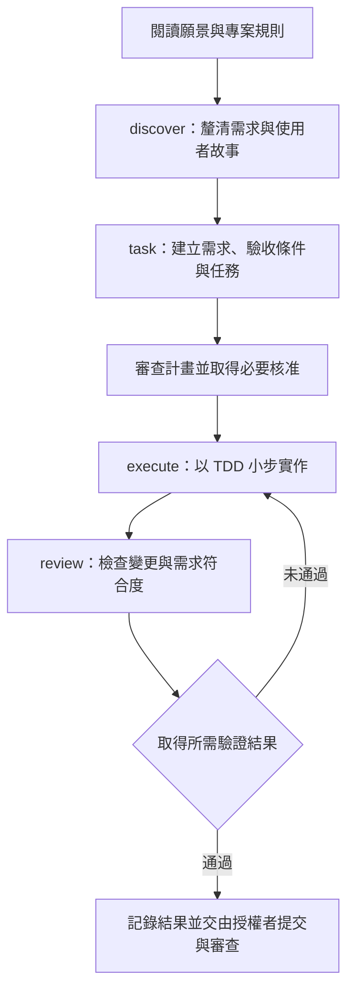

# AIDD 與 Harness Engineering 技術筆記

整理日期：2026-10-28（Asia/Taipei）  
範圍：延續「AIDD AI驅動開發」對話，整理 `paralleldrive/aidd`，並以官方文件補充、校正。本文的 Harness 指 AI Agent 的工作與執行環境，不是同名的 Harness 商業平台。

## 1. 核心定位

**AIDD 是一套可採用的 AI 開發流程與工具框架；Harness Engineering 是設計 Agent 工作環境、約束及回饋機制的工程實務。兩者可以一起使用。**

需要區分兩種 AIDD：

- **AI-Driven Development**：泛指讓 AI 承擔更多程式產生、測試與文件工作的開發方式。
- **`paralleldrive/aidd`**：實作這種方式的具體開源框架，包含 Skills、工作流程、Agent 編排、CLI 與程式庫。名稱中的「standard」是專案自我定位，不代表正式產業標準。[AIDD README](https://github.com/paralleldrive/aidd)

Harness Engineering 的關注點是：Agent 能否取得正確脈絡、操作必要工具、觀察實際結果、從失敗中修正，並維持專案的長期一致性。它也包含文件組織與架構約束，不只是測試腳本或權限開關。[OpenAI 的 Harness Engineering 實務](https://openai.com/index/harness-engineering/)

原對話把兩者簡化為「AIDD 管流程、Harness 管執行」，適合入門，但不是嚴格邊界。AIDD 已提供啟動 Agent 的能力，也能成為團隊 Harness 的一部分。

## 2. AIDD 的主要元件

| 元件 | 用途 | 導入時的理解 |
| --- | --- | --- |
| AIDD CLI | 安裝框架、建立專案、啟動 Agent | 是流程工具入口，不是新的模型 |
| Agent 執行與設定 API | 解析設定並啟動外部 Agent 程序 | 重用 Claude Code 等既有工具 |
| Skills 與工作流程 | 需求探索、任務規劃、TDD、Review | 提供工作方式，仍需驗證結果 |
| SudoLang | 用結構化偽程式碼描述提示、條件與流程 | 是提示表達方式，不等於外部強制執行 |
| 選用的 Server Framework | 提供 JavaScript／TypeScript 伺服器開發工具 | 採用開發流程不代表必須更換後端框架 |

元件依據：[AIDD README](https://github.com/paralleldrive/aidd)、[Agent API](https://github.com/paralleldrive/aidd/blob/main/docs/agent-api.md)。

### 專案脈絡放在哪裡？

| 檔案或目錄 | 角色 |
| --- | --- |
| `vision.md` | 專案目標、限制、架構決策與成功標準 |
| `AGENTS.md` | 指示 Agent 如何找到專案規則與工作流程 |
| `ai/skills/`、`ai/commands/` | 可重用技能與工作流程模板 |
| `aidd-custom/` | 專案專屬規則、Skills 與設定 |

AIDD 的指引要求先閱讀 `vision.md`，並透過索引按需取得脈絡；若任務與願景衝突，先釐清再執行。這是對 Agent 的行為要求，本身不是檔案權限控制。[AIDD AGENTS.md](https://github.com/paralleldrive/aidd/blob/main/AGENTS.md)

專案差異可放在 `aidd-custom/AGENTS.md` 與 `aidd-custom/config.yml`。官方另有 `e2eBeforeCommit` 選項，可影響本機提交前是否執行端到端測試；導入時仍應檢查實際腳本、CI 與團隊權限，不能只看到設定就認定交付已有完整保障。[專案客製化文件](https://github.com/paralleldrive/aidd/blob/main/docs/aidd-custom.md)

## 3. AIDD 工作流程

下圖將原對話流程補上規劃審查與交付驗證，屬於建議用法；它不是每個任務都必須照抄的固定管線。



| 工作流程 | 重點 |
| --- | --- |
| `/discover` | 先決定要解決什麼問題 |
| `/task` | 將需求變成可執行、可驗收的任務 |
| `/execute` | 依需求逐項實作，運用測試驅動開發 |
| `/review` | 可審查計畫與實作結果，找出缺漏或不必要複雜度 |
| `/log` | 記錄變更與進度 |
| `/commit` | AIDD 提供的提交流程；執行權限由團隊決定 |
| `/user-test` | 準備使用者測試腳本，補充部署後驗證 |

這些是 AIDD 定義的 Agent 工作流程名稱，不保證安裝後就成為每個工具的原生斜線指令。應確認工具實際載入的技能與命令。[AIDD 工作流程入口](https://github.com/paralleldrive/aidd/blob/main/ai/skills/aidd-please/SKILL.md)

**套用本次使用者規則時**：程式碼修改仍須先讀取、規劃並取得核准；Git 寫入由使用者自行執行；build、test、lint 預設只提供指令。框架的預設流程不能視為額外授權。

## 4. 如何與 Claude Code 整合？

### 路徑一：在既有 Claude Code 工作方式中採用規則與 Skills

可以先引入願景、任務與審查流程，保留既有專案結構及工具。應確認 Claude Code 真的載入規則，而非只把檔案放進資料夾。

依查閱時的官方文件，`AGENTS.md` 的直接載入取決於版本與設定；預設有符合條件的 `CLAUDE.md`／`CLAUDE.local.md` 時，可能優先使用它們。若需要共用既有規則，可在適當的 `CLAUDE.md` 以 `@AGENTS.md` 匯入，並透過 `/context` 檢查載入狀態。Windows 團隊可優先使用匯入方式，減少符號連結帶來的環境差異。[Claude Code 專案指令文件](https://code.claude.com/docs/en/memory)

### 路徑二：用 AIDD CLI 啟動 Claude Code

AIDD 支援 `claude`、`opencode`、`cursor` 預設設定，也接受自訂 YAML；未另行指定時，最終預設為 `claude`。設定優先順序是：命令列參數 → 環境變數 → 專案設定 → 預設值。[Agent CLI](https://github.com/paralleldrive/aidd/blob/main/docs/agent-cli.md)

以下僅為閱讀與未來試用範例，本次沒有執行安裝或 Agent 任務：

```powershell
# 預覽安裝內容
npx aidd --dry-run

# 在已確認設定與權限的試驗專案中，交由 Claude 分析需求
npx aidd agent --agent-config claude --prompt "閱讀專案規則，分析需求並提出計畫，等待核准後才修改程式碼。"
```

官方 `claude` preset 對應 `claude -p`。AIDD 的 `runAgent` 依程序退出碼決定成功或失敗，因此 **Agent 程序正常結束不等於測試已通過，也不等於需求已完成**。[Agent API](https://github.com/paralleldrive/aidd/blob/main/docs/agent-api.md)

CLI 啟動還需具備可用的 Claude Code、登入及必要權限。AIDD README 的環境要求列出 Unix／Linux shell 或 Windows 搭配 WSL；不可因範例能用 PowerShell 表達，就推定整套流程已在原生 PowerShell 驗證。[AIDD 環境要求](https://github.com/paralleldrive/aidd#-requirements)

## 5. AIDD 與 Harness Engineering 比較

下表是依官方材料整理的概念比較，不是兩個產品的功能評測。

| 面向 | `paralleldrive/aidd` | Harness Engineering |
| --- | --- | --- |
| 定位 | 具體框架、流程與工具組合 | 設計 Agent 工作系統的工程實務 |
| 核心問題 | 如何讓 Agent 按一致流程開發？ | 如何讓 Agent 在實際環境可靠完成工作？ |
| 需求與規格 | 提供探索、任務及願景等慣例 | 決定規格如何被取得、更新與驗收 |
| 脈絡管理 | 願景、索引、Skills、專案客製規則 | 亦涵蓋跨回合狀態、工具結果及知識可發現性 |
| 執行能力 | 可啟動既有 Agent，提供編排相關技能 | 可設計工具介面、權限、隔離、恢復與停止條件 |
| 品質機制 | TDD、Review 與相關開發慣例 | 將檢查結果接回工作迴圈，必要時設置交付門檻 |
| 導入方式 | 選用元件或採用整套框架 | 可從既有工具、少量規則與 CI 開始 |
| 主要成本 | 規則維護、流程適配與額外執行成本 | 環境整合、驗證可靠性與維運成本 |
| 兩者關係 | 可以提供 Harness 所需的部分流程與工具 | 可以納入 AIDD，也可以採用其他流程 |

比較依據：[AIDD README](https://github.com/paralleldrive/aidd)、[OpenAI Harness Engineering](https://openai.com/index/harness-engineering/)、[Anthropic 長時間 Agent 實務](https://www.anthropic.com/research/effective-harnesses-for-long-running-agents)。

## 6. 強制驗證：把「應該做到」變成可檢查的條件

原對話強調「有沒有強制驗證」，方向有用，但更精準的問題是：**關鍵規則由誰檢查？失敗後會發生什麼事？誰能略過它？** AIDD 可以接上強制檢查；使用 Harness 這個名稱也不代表已經具備這些保障。

| 層級 | 做法 | 能證明什麼／限制 |
| --- | --- | --- |
| 行為引導 | 文件要求先寫測試、完成後 Review | 說明預期行為，無法單獨證明已執行 |
| 實際證據 | 留存檢查命令、退出碼、報告與對應版本 | 可以確認檢查發生過，仍要確認測到正確內容 |
| 本機阻擋 | 在適當的 Hook 事件同步檢查並阻擋 | 能控制特定事件，受事件能力與設定範圍限制 |
| 交付門檻 | CI 必要檢查與受保護分支 | 由平台阻止不符合條件的合併，須處理略過權限 |

Claude Code 的 `PreToolUse` 可在工具執行前阻擋；`PostToolUse` 已在操作完成之後，不能把已發生的動作當成尚未發生。不同 Hook 的錯誤與阻擋語意不同，非零退出碼不應一概視為強制阻擋；非同步 Hook 也不適合作為必須當下通過的門檻。[Claude Code Hooks](https://code.claude.com/docs/en/hooks)

以 GitHub 為例，必須設定必要狀態檢查與分支保護，並確認管理員或其他角色的略過權限；僅有一條 CI 工作流程不足以保證阻擋合併。另外，平台可能將 `skipped` 或 `neutral` 視為可接受狀態，因此重要驗收工作應避免被條件誤跳過。[GitHub 分支保護](https://docs.github.com/en/repositories/configuring-branches-and-merges-in-your-repository/managing-protected-branches/about-protected-branches)

### 例子：Refresh Token 的併發需求

以下是驗收設計示例，不是特定認證系統的完整安全設計：

1. 先定義規格：同一個一次性 Refresh Token 同時送出兩個請求時，允許的成功數與失敗回應為何？
2. 把規格變成可重現的整合測試，涵蓋實際資料庫交易與併發情境。
3. 修改後記錄測試結果；失敗時將可重現資訊交回 Agent 或開發者。
4. 修正後重跑相關檢查，並確認結果對應目前待交付的版本。
5. 將必要檢查設為合併條件，保留授權者審查與例外處理。

**測試通過是針對已定義行為的證據，不是整個系統沒有缺陷的證明。** 若實作與測試同時誤解需求，仍可能一起通過；驗收條件與重要測試本身也需要審查。

## 7. 實務導入建議

以下是針對既有專案、在本機使用 Claude Code 的建議，並非 AIDD 官方的必要步驟。

### 第一階段：補上最小必要脈絡

- 用簡短的願景與架構文件說明目標、限制、不可破壞的行為。
- 在工具實際會載入的入口文件連到這些資訊，避免反覆複製相同規則。
- 保留既有的程式碼審查、測試與核准流程，先找出最常出錯的一個環節。

### 第二階段：小範圍試用 AIDD

- 選一個範圍明確的修正或小功能，試用 Task、TDD、Review 流程。
- 比較是否減少需求遺漏、反覆澄清與審查修正，而非只計算產出多少程式碼。
- C#／Vue 等既有專案優先重用原本工具；沒有直接需求時，先略過 AIDD 的 Server Framework、自訂執行器與多 Agent 編排。
- 正式導入前固定採用版本並記錄更新方式，避免試驗結果與未來安裝內容不一致。

### 第三階段：把高價值檢查接成回饋迴圈

- 先選會實際攔下缺陷的測試或架構檢查，讓失敗訊息可被重現與修正。
- 依團隊授權逐步加入本機 Hook 與 CI 門檻；本次「驗證由使用者執行」規則仍有效，未經明確授權不切換成自動執行。
- 自動修正若啟用，設置重試上限、逾時與人工接手條件，避免無限重跑。
- 多回合工作保留已完成事項、未完成驗收與已知問題，讓下一回合可接續工作。這也呼應 Anthropic 對長時間 Agent 的進度交接與增量工作的觀察。[Anthropic 長時間 Agent 實務](https://www.anthropic.com/research/effective-harnesses-for-long-running-agents)

### 值得追蹤的成效

| 指標 | 用途 |
| --- | --- |
| 需求遺漏與驗收失敗次數 | 判斷規劃流程是否有幫助 |
| 審查修正輪數與人工投入時間 | 判斷是否真正節省協作成本 |
| 檢查誤擋、漏擋與不穩定比例 | 判斷門檻是否可信 |
| 每項任務的耗時與模型用量 | 判斷流程複雜度是否值得 |

## 8. 原對話中需要保留與修正的觀念

- **保留**：AIDD 的價值是讓 AI 依工程流程工作，且可搭配 Claude Code。
- **保留**：先建立輕量、可驗證的工作方式，再按需求採用 AIDD 元件。
- **修正**：AIDD 不只是提示詞，也有 CLI、程序執行 API 與編排相關能力。
- **修正**：「強制驗證」不是兩者唯一或絕對的分界；Harness 也包含脈絡、可觀察性、架構約束及跨回合連續性。
- **修正**：安裝工具、程序成功退出、AI 表示完成，均不能取代實際驗收證據。
- **限制**：本筆記根據對話與查閱時的官方文件整理，未安裝 AIDD，未執行 CLI、Hooks、CI 或專案測試，也未確認使用者本機版本；導入前須依固定版本與現有環境核對。

## 參考資料

1. [AIDD 專案與 README](https://github.com/paralleldrive/aidd)
2. [AIDD Agent CLI](https://github.com/paralleldrive/aidd/blob/main/docs/agent-cli.md)
3. [AIDD Agent API](https://github.com/paralleldrive/aidd/blob/main/docs/agent-api.md)
4. [AIDD AGENTS.md](https://github.com/paralleldrive/aidd/blob/main/AGENTS.md)
5. [AIDD 工作流程入口](https://github.com/paralleldrive/aidd/blob/main/ai/skills/aidd-please/SKILL.md)
6. [AIDD 專案客製化](https://github.com/paralleldrive/aidd/blob/main/docs/aidd-custom.md)
7. [Claude Code 專案指令與記憶](https://code.claude.com/docs/en/memory)
8. [Claude Code Hooks reference](https://code.claude.com/docs/en/hooks)
9. [OpenAI：Harness engineering](https://openai.com/index/harness-engineering/)
10. [Anthropic：Effective harnesses for long-running agents](https://www.anthropic.com/research/effective-harnesses-for-long-running-agents)
11. [GitHub：About protected branches](https://docs.github.com/en/repositories/configuring-branches-and-merges-in-your-repository/managing-protected-branches/about-protected-branches)
