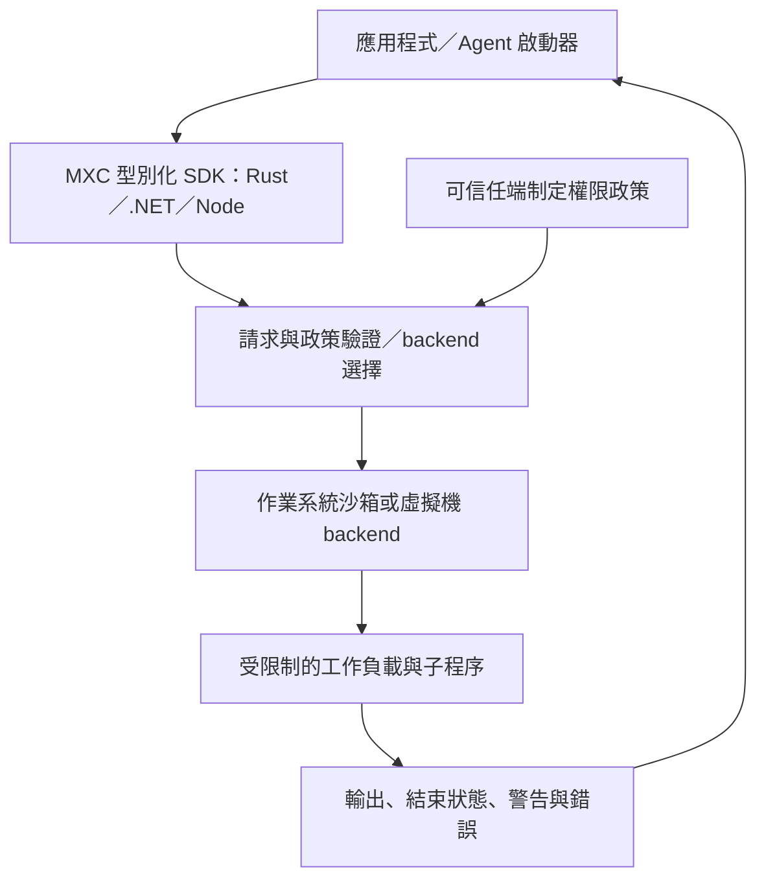
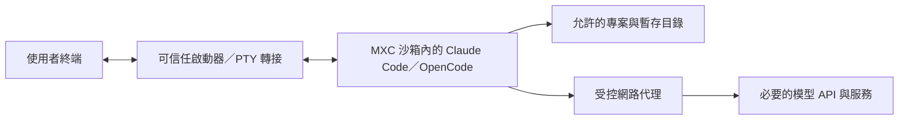

# Microsoft MXC 技術筆記

> 整理日期：2026-10-28（Asia/Taipei）。本筆記承接「分析 MXC Sandbox」對話，並重新核對 Microsoft 官方儲存庫文件。功能描述以查閱當日的 `main` 文件為準，不代表已發布套件必然包含相同功能。本文未在本機安裝或執行 MXC，也未實測 Claude Code／OpenCode 整合。

## 1. 定位與核心價值

**Microsoft eXecution Container（MXC）是一套以政策驅動的跨平台程式碼隔離系統，適合嵌入需要執行不可信程式碼的應用程式。** 典型輸入包括模型產生的程式碼、外掛與工具指令。核心使用 Rust 開發，提供 Rust、.NET、Node SDK，儲存庫採 MIT 授權。

應用程式指定執行命令、隔離方式及權限，MXC 負責驗證請求、選擇 backend，並啟動受限制的工作負載。隔離機制從作業系統原生的程序沙箱到虛擬機都有，因此「使用同一套 API」不代表「每個平台提供相同安全邊界」。

| 能力 | 用途 | 判讀重點 |
|---|---|---|
| 檔案系統政策 | 設定唯讀、可寫、拒絕存取的路徑 | 仍需查看 backend 的基礎開放路徑與例外 |
| 網路政策 | 控制輸出、輸入、主機 loopback 及代理連線 | 主機名稱、IP、連接埠的支援程度不同 |
| UI 政策 | 控制 GUI、剪貼簿與輸入相關能力 | 不保證每個 backend 都支援 |
| 執行與 I/O | 擷取輸出、串流標準輸入輸出、互動式 PTY | 依程式是否需要互動選擇介面 |
| 容器生命週期 | 建立、啟動、執行、停止、釋放 | 持久化能力取決於 backend |
| 診斷與驗證 | 查詢支援程度、驗證政策、分析被拒絕的存取 | 驗證成功仍需實際測試隔離行為 |

MXC 可以成為 Agent 的執行層；Agent 的規劃、模型呼叫、工具選擇與使用者核准流程仍由上層系統負責。它本身不要求 Docker，也不提供 Docker 全部的映像建置、部署與編排功能。

來源：[官方 README](https://github.com/microsoft/mxc/blob/main/README.md)、[授權](https://github.com/microsoft/mxc/blob/main/LICENSE.md)。

## 2. 架構與信任邊界



上圖是概念流程。官方將 SDK 定位為編入或載入應用程式的依賴；具體 runtime、執行器、輔助程序或 VM 的配置依語言套件與 backend 而定，不應解讀成所有隔離工作都只在單一程序內完成。

### 2.1 版本與請求格式

- 公開 SDK 入口採 V1 版本化：`mxc_sdk::v1`、`Microsoft.Mxc.Sdk.V1`、`@microsoft/mxc-sdk/v1`。
- 原生 JSON 政策契約另有版本；SDK API 版本與 JSON 版本是兩個概念。
- 當日政策索引列出：`0.9.0-alpha` 為已發布的最低支援版本、`1.0.0` 為目前穩定契約、`1.1.0-alpha` 為可變動的開發版本。
- JSON 的 `version` 必須是精確字串；缺少、退役或未註冊的版本會被拒絕。只修改舊設定的版本字串，不等於完成遷移。
- Schema 驗證確認資料形狀；backend 還要判斷目前主機能否落實所要求的限制。

### 2.2 一次性與持久化執行

一次性執行以 `ContainerRequest` 描述工作與限制，完成後釋放該次容器。支援持久化生命週期的 backend 則採以下順序：

```text
provision → start → exec（可多次）→ stop → deprovision
```

`provision` 回傳的 `ContainerId` 是不透明識別值，應原樣保存與傳遞。停止和釋放是不同動作；應用程式必須處理取消、逾時及清理失敗。macOS Seatbelt 是程序樹隔離，沒有可命名、重新附加的持久化容器。

來源：[SDK API 索引](https://github.com/microsoft/mxc/blob/main/docs/api-reference/README.md)、[政策版本索引](https://github.com/microsoft/mxc/blob/main/docs/containment-policy/README.md)、[容器生命週期](https://github.com/microsoft/mxc/blob/main/docs/container-lifecycle.md)。

## 3. 跨平台 backend

### 3.1 官方 README 的平台矩陣

| 執行平台 | 預設 backend | 其他列出的 backend |
|---|---|---|
| Windows 11 x64／ARM64 | `processcontainer` | `windows_sandbox`、`wslc`、`microvm`、`hyperlight`、`isolation_session` |
| Linux x64／ARM64 | `bubblewrap` | `lxc`、`hyperlight` |
| macOS ARM64／x64 | `seatbelt` | README 未列其他選項 |

README 在 Windows 列的 `windows_sandbox`、`microvm`、`hyperlight` 標上 experimental；`microvm` 目前僅列為 Windows x64。這不是所有 backend 都有相同成熟度或前置需求的承諾。

### 3.2 選擇時應掌握的差異

| Backend | 定位與前置條件 | 重要限制 |
|---|---|---|
| ProcessContainer | Windows 原生 PSEC 能力；網路使用 WFP 等機制 | 實際 Windows build 與要求功能必須相容；一般程序隔離不等於獨立 VM |
| IsolationSession | Windows 的另一種隔離選項 | 有獨立的 Session Isolation 版本要求，不能只看 Process Isolation 門檻 |
| WSLC | 從 Windows 執行 Linux 容器 | 官方指南要求 WSL 3.0.3+、`wslcsdk.dll` 與可用映像；原生建置需包含 `wslc` feature |
| Bubblewrap | Linux user namespaces，無須 root 的預設 backend | 需要 `bwrap` 0.5.0+；啟用特定網路模式另需 `slirp4netns`、iptables 等工具 |
| LXC | Linux 的其他容器選項 | 按其 backend 文件確認主機設定與權限，不沿用 Bubblewrap 假設 |
| Seatbelt | macOS 核心施行的程序樹沙箱；指南要求 macOS 15+ | 無持久化容器；不支援一般的逐 hostname／IP／CIDR 網路過濾 |
| Windows Sandbox／MicroVM／Hyperlight | 其他隔離選擇；README 中包含實驗性標示 | 逐項確認架構、虛擬化、工作負載與政策支援，不能視為可直接互換 |

Windows 官方版本表的例子：24H2 的 Process Isolation 列為 `26100.9278`，Session Isolation 列為 `26100.9550`；25H2 分別為 `26200.9278` 與 `26200.9550`。這些是查閱當日文件內容，不應只用「Windows 11」推定可用，也不能用來推定所有進階功能均已支援。實際請求還需要 runtime capability probing。

WSLC 的指南另依 WSL 的需求說明較舊 Windows 系統；README 的概覽矩陣與個別 backend 的詳細支援條件應一起閱讀。

來源：[backend 文件目錄](https://github.com/microsoft/mxc/tree/main/docs/backends)、[Windows 版本支援](https://github.com/microsoft/mxc/blob/main/docs/backends/process-container/os-version-support.md)、[WSLC 入門](https://github.com/microsoft/mxc/blob/main/docs/backends/wslc/wsl-container-getting-started.md)、[Bubblewrap](https://github.com/microsoft/mxc/blob/main/docs/backends/bwrap/bubblewrap-backend.md)、[Seatbelt](https://github.com/microsoft/mxc/blob/main/docs/backends/seatbelt/seatbelt-backend.md)。

## 4. Rust、.NET、Node SDK

| SDK | 安裝指令 | 公開入口 | 執行特性 |
|---|---|---|---|
| Rust | `cargo add mxc-sdk` | `mxc_sdk::v1` | 同步 API；把 SDK、engine 與選用 backend 編入應用程式 |
| .NET | `dotnet add package Microsoft.Mxc.Sdk` | `Microsoft.Mxc.Sdk.V1` | 同步／非同步介面；套件包含原生 runtime 資產 |
| Node | `npm install @microsoft/mxc-sdk` | `@microsoft/mxc-sdk/v1` | 提供非同步操作；套件包含原生 runtime 資產 |

Node 應匯入 `/v1`；官方生命週期文件明確指出套件根入口不匯出 API。原生 runtime 隨套件提供，不代表作業系統功能、外部工具與所有 backend 前置條件已經備妥。

### 4.1 常見操作對照

| 需求 | Rust | .NET | Node |
|---|---|---|---|
| 執行並擷取完整輸出 | `run` | `MxcContainer.Run`／`RunAsync` | `run` |
| 啟動並使用即時標準串流 | `spawn` | `MxcContainer.Spawn`／`SpawnAsync` | `spawn` |
| 配置持久化容器 | `container::provision_container` | `MxcLifecycle.ProvisionContainer` | `provisionContainer` |
| 在既有容器執行 | `container::run_in_container` | `RunInContainer`／`RunInContainerAsync` | `runInContainer` |

互動式 CLI 應查閱各 SDK 的 PTY 操作；普通標準串流不等於終端機。完整應用程式也要讀取警告、傳回工作負載結束碼，並區分 SDK 錯誤、程式失敗與逾時。

來源：[Rust API](https://github.com/microsoft/mxc/blob/main/docs/api-reference/rust/v1/README.md)、[.NET API](https://github.com/microsoft/mxc/blob/main/docs/api-reference/dotnet/v1/README.md)、[Node API](https://github.com/microsoft/mxc/blob/main/docs/api-reference/node/v1/README.md)。

## 5. 使用範例與上手流程

### 5.1 官方 Node 最小片段

以下節錄官方 README 的示範，用於說明請求形狀：

```typescript
import { spawn, type ContainerRequest } from '@microsoft/mxc-sdk/v1';

const request: ContainerRequest = {
  command: 'node -e "console.log(\'hello from container\')"',
  network: { egress: { default: 'deny' } },
  timeoutMs: 30_000,
};

const child = await spawn(request);
```

此片段要求預設拒絕對外連線，並設定 30 秒逾時。它沒有展示完整輸出處理、等待、清理、專案路徑授權與 backend 檢查，不能直接當作正式 Agent 啟動器。主機上的 Node 路徑與 runtime 仍須能在沙箱內使用。

原始來源：[README 範例](https://github.com/microsoft/mxc/blob/main/README.md)、[完整標準串流範例](https://github.com/microsoft/mxc/tree/main/samples/run-with-io-stdio-streaming)。

### 5.2 Rust 與 .NET 的完整示範入口

官方將三種 SDK 依情境並列，適合直接比較：

- [Rust 一次性容器範例](https://github.com/microsoft/mxc/blob/main/samples/run-in-transient-container/rust/src/main.rs)：先呼叫 `platform_support()`，建立 `ContainerRequest`，透過 `v1::run` 執行，處理輸出、警告與 `WaitResult`。
- [.NET 一次性容器範例](https://github.com/microsoft/mxc/blob/main/samples/run-in-transient-container/dotnet/Program.cs)：先呼叫 `MxcPlatform.GetPlatformSupport()`，再使用 `MxcContainer.RunAsync`；處理 `TimedOut`、`ExitCode` 與 `MxcException`。
- [完整情境索引](https://github.com/microsoft/mxc/blob/main/samples/README.md)：包含檔案限制、網路限制、PTY、持久化容器、存取拒絕紀錄與支援能力查詢。

取得官方範例並備妥主機後，可在對應語言的範例目錄自行執行：

```powershell
# 在一次性容器範例的 rust 目錄執行
cargo run

# 或在對應的 dotnet 目錄執行
dotnet run
```

這些是供讀者執行的指令，製作本筆記時沒有執行。官方範例參照儲存庫內 SDK，會跟隨原始碼變動；若改用已發布套件，應核對 API 與相依版本。

### 5.3 無法嵌入 SDK 時

官方也提供平台執行器，例如 Windows 的 `wxc-exec.exe`，可接收符合版本化 schema 的 JSON。下列命令假設已有有效設定檔與可用執行器：

```powershell
wxc-exec.exe --debug config.json
```

`--debug` 用於診斷輸出；`--audit` 的安全語意完全不同，詳見第 7 節。

來源：[穩定 schema](https://github.com/microsoft/mxc/tree/main/schemas/stable)、[診斷指南](https://github.com/microsoft/mxc/blob/main/docs/development/guides/diagnostics.md)。

## 6. 與 Claude Code／OpenCode 整合

**以下是根據 MXC 能力提出的整合設計，並非已實測的操作指南。** 本次查閱的官方 README、SDK 索引及 samples 未提供可據以宣稱的 Claude Code／OpenCode 一鍵整合流程；因此不提供假定存在的安裝命令或專用設定欄位。

### 6.1 方式 A：把整個 CLI 放進 MXC



啟動器需要處理以下事項：

1. **主機與政策檢查**：選定 backend，確認能執行該 CLI 與所需子程序；不支援時回報錯誤，不自動退回無隔離執行。
2. **檔案授權**：開放指定專案與必要暫存／快取目錄；工具安裝位置以唯讀為優先。不要為了解決找不到設定檔就開放整個使用者家目錄。
3. **終端互動**：使用 PTY 傳遞輸入、終端尺寸變更、取消及結束事件，並確保工作負載結束後清理資源。
4. **模型網路存取**：依實際使用的供應商、登入方式與功能開放必要目的地。套件下載、Git 操作與外部 MCP 服務各自可能需要不同授權。
5. **登入與憑證**：辨識 CLI 真正需要的環境變數或設定；只注入必要值。任何放進沙箱內的金鑰都應視為沙箱內程式可能讀取，不應把「已隔離」當作憑證保密保證。
6. **工具與外掛邊界**：本機 MCP server、外掛及背景工具若在沙箱外啟動，不會因 CLI 被包住而自動受到同一份政策限制。

### 6.2 方式 B：讓 Agent 留在外部，只隔離工具執行

適用於自己開發的 Agent 平台：模型通訊與憑證由可信任主程序持有；程式碼執行、測試或第三方工具透過 MXC 啟動。這樣可讓不需要網路的工具維持斷網，也可避免把模型 API 憑證交給工作負載。

但對現成 Claude Code／OpenCode，能否攔截所有工具執行，取決於該工具當時提供的擴充介面。只包住 shell 指令，通常不足以證明內建檔案工具、外部服務與所有工具呼叫都被隔離；本文不宣稱這條路徑可以直接套用。

### 6.3 建議的概念驗證順序

先以無憑證、無網路的簡單命令驗證 backend，再測試專案唯讀／可寫邊界及互動式 PTY。接著加入最少的模型連線與登入資料，最後驗證取消、逾時、子程序與清理。套件安裝、Git push、外部資料寫入等額外權限應分別評估。

依據：[PTY 範例](https://github.com/microsoft/mxc/tree/main/samples/run-with-io-pty-interactive)、[檔案隔離範例](https://github.com/microsoft/mxc/tree/main/samples/run-with-containment-of-filesystem)、[網路隔離範例](https://github.com/microsoft/mxc/tree/main/samples/run-with-containment-of-network)。

## 7. 安全限制與注意事項

### 7.1 政策欄位存在，不代表 backend 能完整執行

實際安全性取決於主機、backend、runtime 版本及最終政策。請先查詢支援能力，再驗證完整請求，並保留警告與錯誤。不要只因 JSON 通過 schema，就認定所有限制已生效。

特別是網路控制：

- **ProcessContainer** 的直接輸出規則以數值 IP／CIDR、協定與連接埠為主，不提供持久的 DNS 名稱規則或加密內容檢查。私有網路能力有輸入／輸出耦合，不能任意假設可單獨允許私網輸出而封鎖私網輸入。
- **ProcessContainer proxy-only 模式** 有特定政策組合：輸出預設拒絕、輸入預設允許，以及代理端點與身分設定。這是 backend 特有映射，不能直接把「所有 ingress 都 deny」當成跨平台代理範本。代理由呼叫端建立與維護。
- **Seatbelt** 不支援一般 hostname、IP／CIDR 規則；其輸入連線限制不是逐來源控制。文件記載 `ingress.default: allow` 搭配 `hostLoopback: deny` 時，主機到容器的方向仍有無法完整封閉的例外。
- **Seatbelt 代理模式** 可在核心限制輸出至代理所用端點範圍，但客戶端仍需懂得使用代理；代理轉送到哪些目的地，由代理自身政策決定。開放 host loopback 可能擴大到主機其他連接埠。
- **Bubblewrap** 的斷網與可連網模式需要不同依賴；當日文件說明其 slirp4netns 網路模式沒有 IPv6 連通性，即使規則允許 IPv6 目的地也不代表可達。

因此，單獨設定 `HTTP_PROXY` 不是通用的隔離保證；必須同時確認 backend 封鎖繞過代理的直接連線，且代理本身限制目的地。

來源：[ProcessContainer 網路限制](https://github.com/microsoft/mxc/blob/main/docs/backends/process-container/networking.md)、[Seatbelt 網路與限制](https://github.com/microsoft/mxc/blob/main/docs/backends/seatbelt/seatbelt-backend.md)、[Bubblewrap 網路模式](https://github.com/microsoft/mxc/blob/main/docs/backends/bwrap/bubblewrap-backend.md)。

### 7.2 檔案、環境與秘密資料

授予可寫目錄，就表示工作負載可能修改或刪除其中內容；沙箱不是備份或自動復原機制。專案內的 `.env`、憑證、設定檔與快取也要納入權限設計。

環境變數「省略」與「明確傳入空集合」的語意不同，不能假設所有 backend 都會複製宿主環境。Seatbelt 文件另提醒，預設 `HOME` 可能指向工作目錄，導致專案中的 dotfiles 被工具當作使用者設定；處理不可信專案時應明確考慮這個邊界。

Seatbelt 的 `guiAccess`、`keychainAccess` 會擴大能力；`profileOverride` 更會取代產生的政策，使共用 filesystem／network／UI 設定不參與 profile 生成。使用這些選項時需重新檢視有效限制。

來源：[SDK 結果與政策語意](https://github.com/microsoft/mxc/blob/main/docs/api-reference/README.md)、[Seatbelt 設定與環境](https://github.com/microsoft/mxc/blob/main/docs/backends/seatbelt/seatbelt-backend.md)。

### 7.3 `--audit` 會關閉沙箱安全限制

**官方明確警告：`--audit` 會關閉被分析工作負載的所有沙箱安全限制，不可用於執行不可信程式碼。** 它用來觀察可信工具實際需要的存取，協助制定 ProcessContainer 政策。

需要觀察被阻擋的存取時，先查看保留限制的 deny-and-record／capture 工作流程；不要把 audit 當成「只是多寫一些日誌」的安全執行模式。

來源：[存取拒絕與 audit 文件](https://github.com/microsoft/mxc/blob/main/docs/logging-access-denied.md)。

### 7.4 遙測

官方 Microsoft build 的診斷遙測預設關閉；官方 README 說明，必須同時符合該次執行選擇啟用、Windows 使用者明確同意、管理政策允許，以及應用程式在請求中啟用等條件。管理員可禁止收集，不能替使用者授予同意。

本機開源建置沒有設定導向 Microsoft 的遙測目的地；非 Windows 平台的遙測操作為 no-op。實際採用前應核對使用的發行套件與遙測文件。

來源：[遙測政策與同意](https://github.com/microsoft/mxc/blob/main/docs/telemetry.md)、[README 遙測說明](https://github.com/microsoft/mxc/blob/main/README.md)。

### 7.5 隔離仍有邊界

以下是導入時的工程判斷：作業系統漏洞、過度授權、外部代理或工具服務的弱點，仍可能削弱整體保護。已允許的網路目的地也可能成為資料外送通道；沙箱不會判斷模型回覆或檔案修改是否符合使用者意圖。

若目標包含惡意多租戶程式執行，應另外進行威脅建模與資源耗用測試。執行逾時不能直接等同完整的 CPU、記憶體、磁碟與程序數量配額。

## 8. 適用情境與採用建議

| 情境 | 評估 |
|---|---|
| 自建 AI Agent 平台，執行模型產生的程式碼 | 值得評估，可把隔離整合在工具執行邊界 |
| .NET 後端需要執行外掛、CLI 或不可信工作 | 有型別化 SDK 可用，但需確認服務帳號、主機與 backend 條件 |
| 跨 Windows／Linux／macOS 的開發工具 | 可共用概念與 API；仍需分平台驗證政策 |
| Windows 上執行 Linux 工具鏈 | 可研究 WSLC，另行處理 WSL、SDK runtime 與映像來源 |
| 想立刻把 Claude Code／OpenCode 全面隔離 | 需要啟動器、終端、登入與網路整合成本，不能只安裝套件便視為完成 |
| 高風險公開程式執行或多租戶服務 | 需更完整的安全設計、配額、監控及 backend 審查 |

實務上，先從單一平台、單一工具與一份最小政策開始。以「允許的事情能完成，禁止的事情確實失敗」作為驗收條件，比只確認程式能啟動更有意義。

## 9. 建議自行驗證的項目

本節是後續概念驗證清單，本文未執行這些測試。

- 主機支援探測與完整請求驗證是否成功；不支援時是否停止執行。
- 允許讀取的檔案可讀、唯讀檔案不能修改、未授權路徑不能存取。
- 禁止對外網路時，直接 IP、DNS、IPv6 與主機 loopback 的行為是否符合所選 backend 的承諾。
- 代理模式下，忽略代理環境變數的程式是否仍被阻擋；代理是否拒絕未授權目的地。
- 使用虛構憑證測試環境變數與日誌，確認未將不必要的宿主秘密帶入或輸出。
- 子程序、PTY、取消與逾時後是否仍有殘留程序；持久化容器是否確實停止及釋放。
- 在每個目標 OS／架構與固定套件版本重做驗證，不以另一平台的結果代替。

起點：[不啟動容器的支援檢查範例](https://github.com/microsoft/mxc/tree/main/samples/dryrun-check-containment-support)。

## 10. 官方來源索引

| 主題 | 官方連結 |
|---|---|
| 專案與 README | [microsoft/mxc](https://github.com/microsoft/mxc) |
| Rust 套件 | [mxc-sdk](https://crates.io/crates/mxc-sdk) |
| .NET 套件 | [Microsoft.Mxc.Sdk](https://www.nuget.org/packages/Microsoft.Mxc.Sdk) |
| Node 套件 | [@microsoft/mxc-sdk](https://www.npmjs.com/package/@microsoft/mxc-sdk) |
| SDK API | [docs/api-reference](https://github.com/microsoft/mxc/blob/main/docs/api-reference/README.md) |
| 官方範例 | [samples](https://github.com/microsoft/mxc/blob/main/samples/README.md) |
| 政策契約與版本 | [containment-policy](https://github.com/microsoft/mxc/blob/main/docs/containment-policy/README.md) |
| 穩定 JSON schema | [schemas/stable](https://github.com/microsoft/mxc/tree/main/schemas/stable) |
| Backend 指南 | [docs/backends](https://github.com/microsoft/mxc/tree/main/docs/backends) |
| 生命週期 | [container-lifecycle.md](https://github.com/microsoft/mxc/blob/main/docs/container-lifecycle.md) |
| 存取拒絕診斷 | [logging-access-denied.md](https://github.com/microsoft/mxc/blob/main/docs/logging-access-denied.md) |
| 遙測 | [telemetry.md](https://github.com/microsoft/mxc/blob/main/docs/telemetry.md) |
| 授權 | [LICENSE.md](https://github.com/microsoft/mxc/blob/main/LICENSE.md) |

維護提醒：本文連結多指向可變動的 `main`。正式採用時應固定 SDK 套件版本與對應原始碼 revision，並重新核對 backend 與政策契約；不以 star 數、更新頻率或「sandbox」名稱推定安全性與成熟度。
